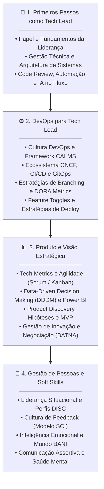

# 🚀 Formação Tech Lead — Rocketseat | Notas & Estudos

<p align="center">
  
  
  
  
</p>

---

## 📌 Sobre o Repositório

Repositório dedicado ao registro de anotações, resumos teóricos, mapas mentais, códigos de apoio, estudos de caso e projetos práticos desenvolvidos durante a **[Formação Tech Lead da Rocketseat](https://app.rocketseat.com.br/jornada/tech-lead/visao-geral)**.

O objetivo principal desta formação é capacitar o profissional técnico a realizar a transição do papel de executor (*desenvolvedor sênior/especialista*) para o papel de **Líder Técnico protagonista**, equilibrando com excelência:
- **Visão Arquitetural & Excelência Técnica**
- **Cultura DevOps & Métricas de Engenharia**
- **Produto, Negócio & Tomada de Decisão Baseada em Dados**
- **Gestão de Pessoas, Inteligência Emocional & Soft Skills**

---

## 🗺️ Visão Geral do Conteúdo Programático

A formação é dividida em 4 grandes pilares estratégicos:



---

## 📚 Estrutura Detalhada dos Módulos

### 🧭 Módulo 01: Primeiros Passos como Tech Lead (`n1_primeiros_passos_como_techlead`)
> *Fundamentos da liderança técnica, transição de carreira, tomada de decisão e qualidade de código.*

- [x] **O Papel do Tech Lead** ([`sn1_primeiros_passos_como_techlead`](./n1_primeiros_passos_como_techlead/sn1_primeiros_passos_como_techlead/)):
  - Responsabilidades, limites de atuação, habilidades em T (*T-Shaped*) e equilíbrio entre código, pessoas e negócio ([`primeiros_passos_tech_lead.md`](./n1_primeiros_passos_como_techlead/sn1_primeiros_passos_como_techlead/primeiros_passos_tech_lead.md)).
- [x] **Gestão Técnica e Arquitetura** ([`sn2_gestao_tecnica_arquitetura`](./n1_primeiros_passos_como_techlead/sn2_gestao_tecnica_arquitetura/)):
  - Estratégias técnicas, RFCs, ADRs, POCs e mitigação de débitos ([`estrategias_tecnicas.md`](./n1_primeiros_passos_como_techlead/sn2_gestao_tecnica_arquitetura/estrategias_tecnicas.md)).
  - Conectando pontos entre visão local e visão global ([`conectando_pontos.md`](./n1_primeiros_passos_como_techlead/sn2_gestao_tecnica_arquitetura/conectando_pontos.md)).
  - Fundamentos de arquitetura de sistemas escaláveis ([`arquitetura_sistemas.md`](./n1_primeiros_passos_como_techlead/sn2_gestao_tecnica_arquitetura/arquitetura_sistemas.md)).
  - Observabilidade e monitoramento: Logs, Métricas e Traces ([`observabilidade.md`](./n1_primeiros_passos_como_techlead/sn2_gestao_tecnica_arquitetura/observabilidade.md)).
- [x] **Code Review & Engenharia de Qualidade** ([`sn3_code_review`](./n1_primeiros_passos_como_techlead/sn3_code_review/)):
  - Introdução e padrões de revisão sob o olhar de liderança técnica ([`introducao_code_review.md`](./n1_primeiros_passos_como_techlead/sn3_code_review/introducao_code_review.md), [`code_review_eficaz.md`](./n1_primeiros_passos_como_techlead/sn3_code_review/code_review_eficaz.md)).
  - Padronização com *Conventional Commits* e boas práticas de *Pull Requests* ([`conventional_commits.md`](./n1_primeiros_passos_como_techlead/sn3_code_review/conventional_commits.md), [`pull_requests.md`](./n1_primeiros_passos_como_techlead/sn3_code_review/pull_requests.md)).
  - Projeto prático de automação com *Commitlint*, *Husky*, *Commitizen* e *Semantic Release* ([`example_project_commit_techlead_class`](./n1_primeiros_passos_como_techlead/sn3_code_review/example_project_commit_techlead_class/)).
- [x] **Quiz Avaliativo**: Primeiros Passos como Tech Lead.

---

### ⚙️ Módulo 02: DevOps para Tech Lead (`n2_devops_para_techlead`)
> *Cultura ágil de operações, automação de esteiras, métricas de entrega e confiabilidade.*

- [x] **A Origem do DevOps** ([`sn1_origem_devops`](./n2_devops_para_techlead/sn1_origem_devops/)):
  - Contexto inicial do papel de DevOps junto à liderança técnica ([`origem_devops.md`](./n2_devops_para_techlead/sn1_origem_devops/origem_devops.md)).
  - Da Revolução Industrial ao Lean Manufacturing (Sistema Toyota, Just-In-Time, Jidoka e Kaizen) aplicado ao software ([`a_revolucao_industrial.md`](./n2_devops_para_techlead/sn1_origem_devops/a_revolucao_industrial.md), [`objetivos_lean_manufacturing.md`](./n2_devops_para_techlead/sn1_origem_devops/objetivos_lean_manufacturing.md)).
  - Evolução da computação e da infraestrutura: de Mainframes a Containers, Serverless e IaC ([`a_evolucao_da_computacao_e_da_infraestrutura.md`](./n2_devops_para_techlead/sn1_origem_devops/a_evolucao_da_computacao_e_da_infraestrutura.md)).
  - O resultado da evolução tecnológica, disrupção de mercado e o software no centro do negócio ([`o_resultado_da_evolucao_da_tecnologia.md`](./n2_devops_para_techlead/sn1_origem_devops/o_resultado_da_evolucao_da_tecnologia.md)).
  - Dívida técnica: causas comuns, impactos e estratégias de mitigação ([`divida_tecnica.md`](./n2_devops_para_techlead/sn1_origem_devops/divida_tecnica.md)).
  - O conflito histórico entre áreas (Dev vs. Ops) e a eliminação de silos ([`o_conflito_entre_areas.md`](./n2_devops_para_techlead/sn1_origem_devops/o_conflito_entre_areas.md)).
- [ ] **Introdução ao DevOps para Líderes** ([`sn2_introducao_à_devops_para_líderes`](./n2_devops_para_techlead/sn2_introducao_à_devops_para_líderes/)):
  - As Três Maneiras: Fluxo, Feedback Rápido e Aprendizado Contínuo com Experimentação.
  - O framework **CALMS** (*Culture, Automation, Lean, Measurement, Sharing*).
- [ ] **Landscape e Ferramentas DevOps (CNCF)**:
  - Ecossistema Cloud Native Computing Foundation.
  - CI/CD contínuo e GitOps.
- [ ] **Controle de Versão e Estratégias de Branching**:
  - GitFlow, Release Branch e Trunk-Based Development.
  - Políticas de branches seguras e proteção de release.
- [ ] **Medindo Desempenho com DORA Metrics**:
  - *Deployment Frequency* (Frequência de Deploy).
  - *Lead Time for Changes* (Tempo de entrega de alterações).
  - *Change Failure Rate* (Taxa de falhas em mudanças).
  - *Time to Restore Service* / MTTR (Tempo médio de recuperação).
- [ ] **Feature Toggles**:
  - Tipos de toggles (Release, Experiment, Ops, Permission).
  - Testes em produção e redução de risco de deploy.
- [ ] **Estratégias de Deploy**:
  - Rolling Deployment, Blue-Green Deployment e Canary Releases.
- [ ] **Quiz Avaliativo & Microcertificação**: DevOps & Liderança Técnica.

---

### 📊 Módulo 03: Produto e Visão Estratégica
> *Alinhamento técnico ao negócio, metodologias ágeis, métricas e tomada de decisão orientada a dados.*

- [ ] **Tech Metrics**:
  - Métricas de engenharia, métricas ágeis, SRE e eficiência de times distribuídos.
- [ ] **Metodologias Ágeis**:
  - Princípios da agilidade além da cerimônia.
  - Aplicação prática de Scrum e Kanban para fluxo contínuo de valor.
- [ ] **Data-Driven Decision Making (DDDM)**:
  - Intuição vs. Evidência em decisões técnicas.
  - Qualidade de dados, amostragem e estatística aplicada à engenharia.
- [ ] **DDDM na Prática com Power BI**:
  - Dashboards interativos de produtividade, tempos de ciclo e gargalos de entrega.
- [ ] **Product Discovery & Design**:
  - Validação de hipóteses, ideação de MVPs e critérios de pivotagem.
  - Antecipação de riscos técnicos e arquiteturais no início do discovery.
- [ ] **Gestão e Estratégia de Inovação**:
  - Mapeamento e engajamento de *stakeholders*.
  - Negociação baseada em princípios e frameworks como **BATNA** (*Best Alternative to a Negotiated Agreement*).
  - Definição de MTP (*Massive Transformative Purpose*) e otimização do fluxo de valor.
- [ ] **Quiz Avaliativo & Microcertificação**: Produto e Visão Estratégica.

---

### 🤝 Módulo 04: Gestão de Pessoas e Soft Skills
> *Desenvolvimento de pessoas, inteligência emocional, resolução de conflitos e comunicação de alto impacto.*

- [ ] **Gestão de Pessoas & Cultura de Feedback**:
  - Estilos de liderança situacional.
  - Análise de perfis comportamentais (**DISC**).
  - Feedback estruturado com o **Modelo SCI** (*Situação, Comportamento, Impacto*).
  - Gestão de conflitos técnicos e interpessoais, delegação e avaliação de desempenho.
- [ ] **Inteligência Emocional**:
  - Os 5 pilares da Inteligência Emocional e neurociência aplicada.
  - Autoconhecimento, autogestão e resiliência em cenários **BANI** (*Brittle, Anxious, Non-linear, Incomprehensible*).
- [ ] **Comunicação Clara e Eficaz**:
  - Comunicação assertiva, escuta ativa e redução de ruídos.
  - Facilitação de alinhamentos técnicos e discussões de arquitetura.
- [ ] **Saúde Mental e Performance Sustentável**:
  - Prevenção a burnout, ansiedade e sobrecarga em times de tecnologia.
  - Criação de ambientes psicologicamente seguros para inovação.
- [ ] **Quiz Avaliativo & Certificado Final**: Formação Tech Lead Rocketseat.

---

## 📂 Organização das Pastas do Repositório

Estrutura atual das notas de estudo padronizada por níveis (`n1`, `n2`...) e subníveis (`sn1`, `sn2`...):

```text
formação_tech_lead/
├── README.md
├── documentos/
│   └── guia_mermaid.md
├── n1_primeiros_passos_como_techlead/
│   ├── apresentações/
│   ├── sn1_primeiros_passos_como_techlead/
│   │   ├── assets/
│   │   └── primeiros_passos_tech_lead.md
│   ├── sn2_gestao_tecnica_arquitetura/
│   │   ├── assets/
│   │   ├── arquitetura_sistemas.md
│   │   ├── conectando_pontos.md
│   │   ├── estrategias_tecnicas.md
│   │   └── observabilidade.md
│   └── sn3_code_review/
│       ├── code_review_eficaz.md
│       ├── conventional_commits.md
│       ├── introducao_code_review.md
│       ├── pull_requests.md
│       └── example_project_commit_techlead_class/
└── n2_devops_para_techlead/
    ├── apresentações/
    ├── sn1_origem_devops/
    │   ├── origem_devops.md
    │   ├── a_revolucao_industrial.md
    │   ├── objetivos_lean_manufacturing.md
    │   ├── a_evolucao_da_computacao_e_da_infraestrutura.md
    │   ├── o_resultado_da_evolucao_da_tecnologia.md
    │   ├── divida_tecnica.md
    │   └── o_conflito_entre_areas.md
    └── sn2_introducao_à_devops_para_líderes/
```

---

## 🛠️ Ferramentas, Conceitos & Frameworks Estudados

| Categoria | Tópicos & Tecnologias |
|---|---|
| **Liderança & Gestão** | Perfil T-Shaped, DISC, Modelo SCI, Liderança Situacional, 1-on-1s, Avaliação de Desempenho |
| **Arquitetura & Estratégia Técnica** | RFC, ADR, POC, Observabilidade (Logs, Métricas, Traces), Mitigação de Dívida Técnica |
| **Engenharia & Qualidade** | Code Review, Conventional Commits, Pull Requests, Husky, Commitlint, Commitizen, Semantic Release |
| **DevOps & Infra** | Lean Manufacturing (JIT, Jidoka, Kaizen), Evolução de Infraestrutura (VMs, Containers, Serverless, IaC), CALMS, DORA Metrics, CNCF, CI/CD, GitOps |
| **Estratégias de Deploy** | Feature Flags, Rolling, Blue-Green, Canary Releases |
| **Dados & Produto** | DDDM (Data-Driven Decision Making), Power BI, Product Discovery, MVP |
| **Negociação & Estratégia** | BATNA, Principled Negotiation, MTP, Mapeamento de Stakeholders |
| **Soft Skills** | Inteligência Emocional, Comunicação Assertiva, Mundo BANI, Segurança Psicológica |

---

## 🔗 Links Úteis & Referências

- [Página Oficial da Formação Tech Lead - Rocketseat](https://app.rocketseat.com.br/jornada/tech-lead/visao-geral)
- [DORA Metrics Guide (Google Cloud)](https://cloud.google.com/devops)
- [Cloud Native Computing Foundation (CNCF Landscape)](https://landscape.cncf.io/)
- [Architecture Decision Records (ADRs)](https://adr.github.io/)

---

## 📝 Licença

Este repositório está sob a licença [MIT](LICENSE). Sinta-se à vontade para utilizar as anotações e resumos como referência em seus próprios estudos.
