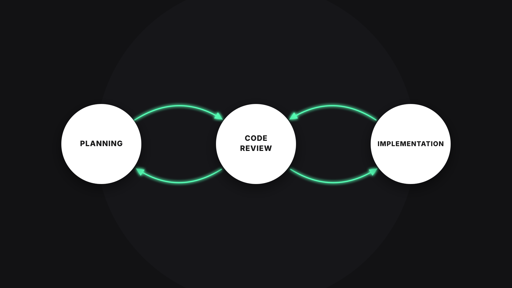
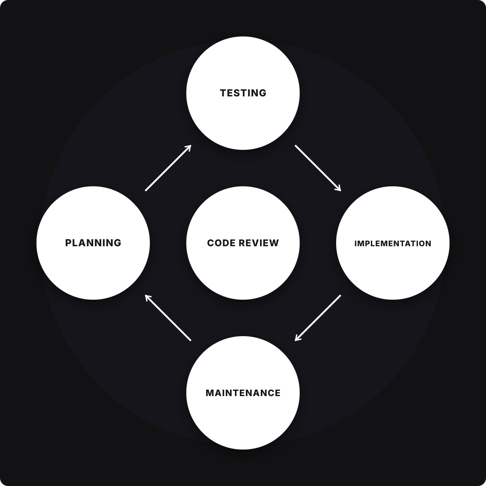

# Code Review e Sua Importância

## Code Review Líder Técnico

1. Escalabilidade
2. Manutenibilidade
3. Qualidade contínua

- Maior responsabilidade é colocar ordem na casa
- Quando e como estamos lidando com pessoas, é importante que a gente tente se comunicar, que possa trazer o entendimento, passar uma idéia e trazer uma confiança pra as pessoas, para que elas sigam na direção mais correta.
- Como líderes técnicos é necessário enxergar qual é essa direção correta e temos que ter essa visibilidade técnica, um pouco além do que só do problema que estamos vendo e aplicar assim no time, para que possamos deixar o time mais performático, trazer confiança e poder fazer com que os participantes do nosso time, eles possam evoluir.
- A responsabilidade em si do Líder Técnico é pegar esse conceitos meio turvos e trazer uma clareza, uma qualidade, uma consistência, uma pré-visibilidade, fazer com que as pessoas consigam entender o porque que elas estão fazendo aquilo...e assim, consigam repetir os mesmos padrões, para que a gente tenha em si um time performático.

## Impacto Estratégico Code Review

- ### Qualidade em escala
  - Qual o impacto estratégico?
  - É importante criar um certo padrão, para que as coisas sejam mais previsíveis, para que as coisas dentro do meu código possam fazer um sentido maior, com esses padrões, nosso cerébro vai entendendo e abstraindo um pouco mais desses itens e assim absorver mais o que aquele código quer me passar de informação, me deixando assim mais familiarizado com a base de código.
  - Code reviews garantem que a base de código se mantenha consistente ao longo do tempo.
  - Os padrões são importantes para que? Esse questionamento já faz gancho com o proxímo ponto, ou seja, é crucial que decisões técnicas e padrões sejam seguidos para evitar problemas futuros. Para existir padrões de projeto, é necessário a constância e consistência dentro do código.
  - Code review eficaz impede a introdução de dúvidas técnicas que podem crescer exponencialmente.
    - Nesse ponto conseguimos deixar bem claro, quais são as responsabilidades, quais são os objetivos, qual é a direção que estamos tomando dentro do código, deixando assim mais fácil de guiar o time para uma excelência técnica.

- ### Riscos de Segurança
  - Um dos maiores riscos em sistemas de grande porte é a vulnerabilidade de segurança.
    - Como líder técnico, é preciso que você traga essa consciência para dentro do time, que isso vire itens de boas práticas, para que possamos manter uma qualidade dentro do time, para que as pessoas introduzam riscos de segurança e vulnerabilidades dentro da aplicação
  - Code reviews ajudam a identificar vulnerabilidades potenciais.
  - Promove uma cultura de identificação proativa de falhas de segurança, como autenticação, validação de dados e segurança de APIs.

- ### Crescimento Profissional
  - Code reviews são uma escelente oportunidade de mentoria.
    - Muitas vezes se o time tem júniors, mid-levels e se você ainda não é Tech Lead, essa é uma das skins que você precisa abordar, aceitar ou até performar desse jeito, para quando você estiver ali revisando código, se portar como mentor.
  - O líder técnico deve usar esse processo para ensinar e compartilhar conhecimentos com sua equipe.
  - Isso fortalece a coesão do time, além de elevar o nível técnico de todos.
    - É muito importante que a gente saiba qual a linguagem que estamos passando no PR, que o próprio Pull Request a gente veja como uma oportunidade de aprendizado, tanto para a pessoa que você estiver revisando, quanto para a pessoa que esta revisando para você, buscar trazer sempre feedbacks construtivos, de qualidade e poder compartilhar conhecimento.
    - Precisamos ser essa figura, aonde as pessoas vão vir para a gente, pedindo ajuda e nos iremos conseguir compartilhar o conhecimento, para fortalecer a coesão do time.
    - A idéia central é trazer uma sólides no time.
    - Tendo objetivo aonde todos irão aprender, inclusive o prório Líder Técnico.

## Líder Técnico no Code Review

- ### Padrões Técnicos e de Qualidade
  - Definir padrões de qualidade que a equipe equipe deve seguir durante o desenvolvimento do código.
    - utilizar ferramentas automatizadas que podemos colocar em pipelines no github, para detectar code smells quanto também padrões de código que nos devemos também seguir dentro das nossas aplicações.
  - Code review permite acompanhar de perto o progresso da qualidade do código ao longo do tempo.
    - É possível ver relatórios de modificações de arquivos, para que seja possivel monitorar a quantidade de vezes que foi modificado e também a porcentagem de qualidade que o mesmo se encontra hoje.
  - Isso ajude a identificar padrões negativos repetitivos, como falta de testes.

- ### Cultura de Code Review Positiva
  - O code review deve ser visto como uma oportunidade de aprendizado e colaboração, e não como uma crítica.
    - Buscar sempre oprtunidades de aprendizado
    - Porque em algum momento no code review algum erro ou situação vai ficar evidente, para isso, é muito melhor ter a iniciativa de procurar perguntar e mostrar a dúvida, evitando assim erros futuros e ter uma code review realmente positiva.
  - Coaching é a parte do seu papel ajudando os membros da equipe a entender o racional por trás das escolhas técnicas.
    - Nesse momento muitas vezes é necessário 'sair' do papel de técnico e assumir o coach e dar direção para as pessoas do time, mostrando por exemplo, que em determindado momento o desenvolvedor não entendeu o que deveria ser feito ou que a funcionalidade que foi levantada não ta 100% funcional ou completa, falta um teste, uma melhoria e com base nisso poderiamos trabalhar para realmente replicar iso de forma melhor
    - Trazer essa visão é extremamente importante, pois, uma vez que o time se sente livre para trazer idéias, fazer perguntas, ter essa sinergia, o time em si, ele se fortalece, fica mais performático, muito mais alinhado e as pessoas começam a trabalhar juntos, trazendo resultados incríveis, tanto na parte de decisões técnicas, quanto na parte de trazer novas idéias, até mesmo mitigar os problemas de padrões de segurança, falta de teste e etc.

## Parte da Estratégia do Projeto

- Todo momento que estivemos implementando, vai existir Code Review.
- Quando estiver planejando fazer o seu software, vai existir um Code Review.
  
- Planejamento de novas funcionalidades e assim termina com o clico completo do software
  

## Liçoes 📓

- Code review deve ser visto como uma oportunidade estratégica, não apenas técnica.
  - Momentos de aprendizado, aonde o Líder técnico desempenha o papel de coach para o time, trazendo qualidade para o nosso codigo, fazendo o time em si ser mais performático
- Como líder técnico, seu papel no code review vai além de verificar erros, você deve orientar e ensinar.
- A integração de code review no ciclo de vida do projeto assegura que a qualidade seja mantida ao longo do tempo.
  - É muito bom trazer indicadore e dados técnicos como o quanto foi melhorado do código, o quão mais performático o código ficou, quanto o time aprendeu nessa trajetória, visualizar também quantidade de PR's abertos, verificando também a velocidade que estão se desenvolvendo features
  - Com relação a ciclo de vida de software é possível tirar muitas métricas de um code review.
