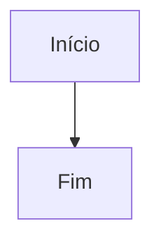
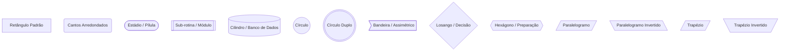
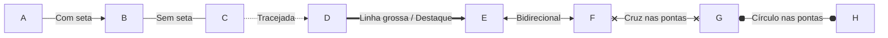
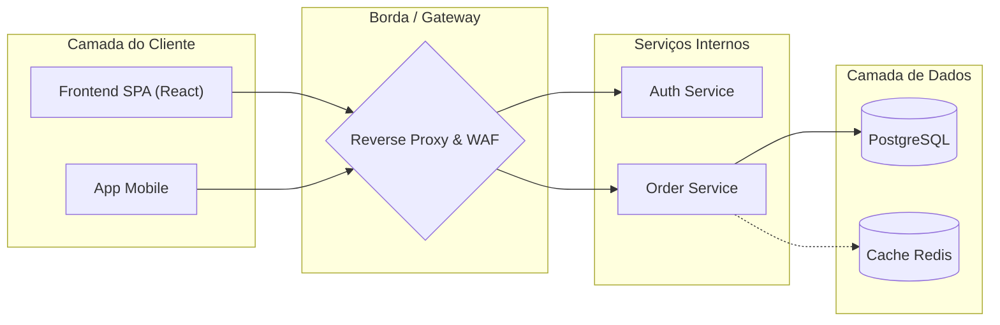
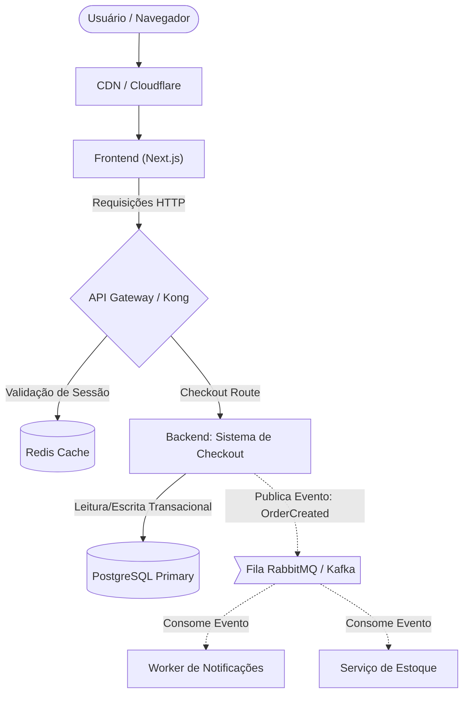

# Guia de Referência Mermaid: Formas, Sintaxe e Diagramas de Arquitetura

Este guia serve como material de consulta rápida para criação de diagramas técnicos e arquiteturais utilizando **Mermaid.js** no Markdown.

---

## 1. Como Usar

Para renderizar um diagrama no Markdown, utilize o bloco de código com o identificador `mermaid`:

````markdown

````

---

## 2. Direções do Fluxo (`flowchart` / `graph`)

A primeira linha define o tipo e a direção do diagrama:

| Código | Orientação | Sentido |
| :--- | :--- | :--- |
| `flowchart TD` ou `TB` | Vertical | De cima para baixo (*Top to Down / Bottom*) |
| `flowchart BT` | Vertical | De baixo para cima (*Bottom to Top*) |
| `flowchart LR` | Horizontal | Da esquerda para a direita (*Left to Right*) |
| `flowchart RL` | Horizontal | Da direita para a esquerda (*Right to Left*) |

---

## 3. Catálogo de Formas dos Nós (Node Shapes)

No Mermaid, a forma geométrica do nó é definida pelos delimitadores ao redor do rótulo:



### Tabela de Sintaxe e Semântica de Arquitetura

| Sintaxe | Forma | Nome | Uso Recomendado em Arquitetura |
| :--- | :--- | :--- | :--- |
| `id[Texto]` | Retângulo | Padrão | Serviços, APIs, microsserviços, componentes gerais |
| `id(Texto)` | Cantos Arredondados | Arredondado | Ações do usuário, passos de interface, eventos leves |
| `id([Texto])` | Estádio / Pílula | Stadium | Pontos de entrada/saída, início e fim de fluxos |
| `id[[Texto]]` | Retângulo Duplo | Sub-rotina | Módulos externos, bibliotecas, processos pré-definidos |
| `id[(Texto)]` | Cilindro | Database | Bancos de dados relacionais, NoSQL, caches em disco |
| `id((Texto))` | Círculo | Círculo | Conectores de fluxo, junções, nós simples |
| `id(((Texto)))` | Círculo Duplo | Double Circle | Evento final com destaque, ponto de parada |
| `id>Texto]` | Bandeira | Assimétrico | Mensagens, eventos publicados, notificações |
| `id{Texto}` | Losango | Decisão | Bifurcações condicionais, validações, balanceadores (*if/else*) |
| `id{{Texto}}` | Hexágono | Hexagon | Configuração, bootstrap, rotinas agendadas (Cron jobs) |
| `id[/Texto/]` | Paralelogramo | Input / Output | Entrada/saída de dados externos, uploads |
| `id[\Texto\]` | Paralelogramo Invertido | I/O Alternativo | Leitura/escrita de arquivos ou logs |
| `id[/Texto\]` | Trapézio | Trapezoid | Processamento ou intervenção manual |
| `id[\Texto/]` | Trapézio Invertido | Inverted Trapezoid | Consolidação ou agregação manual |

> [!TIP]
> **Caracteres Especiais:** Se o rótulo do nó tiver espaços, dois-pontos (`:`), parênteses `()` ou colchetes `[]`, sempre use aspas duplas:
> ```mermaid
> flowchart LR
>     API["Backend: Sistema de Checkout (v2)"]
> ```

---

## 4. Tipos de Conexões e Setas

Você pode customizar o estilo das linhas e adicionar textos sobre elas:



### Sintaxe das Conexões

| Sintaxe | Renderização | Uso Típico |
| :--- | :--- | :--- |
| `A --> B` | Linha sólida com seta | Chamada HTTP/REST síncrona, fluxo padrão |
| `A --- B` | Linha sólida simples | Ligação ou associação sem direção rígida |
| `A -.-> B` | Linha tracejada com seta | Comunicação assíncrona, eventos, Webhooks |
| `A ==> B` | Linha grossa com seta | Fluxo principal, alta volumetria, conexão crítica |
| `A <--> B` | Bidirecional | WebSockets, comunicação full-duplex |
| `A -->|Texto| B` | Linha com texto explicativo | Indicação de protocolo, payload ou status |
| `A -- "Texto com espaços" --> B` | Linha com texto entre aspas | Rótulos longos ou com caracteres reservados |

---

## 5. Agrupamentos com Subgrafos (`subgraph`)

Subgrafos são fundamentais para delimitar fronteiras de arquitetura (ex: camadas, VPCs, clusters, provedores de cloud):



---

## 6. Exemplo de Arquitetura Completo: Sistema de E-Commerce Escalável

Exemplo prático de uma arquitetura resiliente com caching e mensageria assíncrona:


