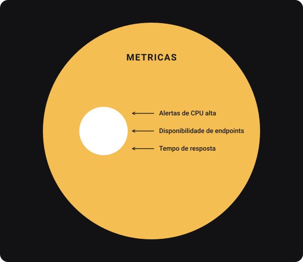

# Conectando os Pontos

1. Soluções Locais vs. Globais
   - ## O Equilíbrio é a 🔑
     - Ao longo do processo de otimização e tomada de decisões técnicas, é importante entender que não há uma solução única que funcione para todos os cenários. A chave para o sucesso é balancear soluções locais e globais de acordo com as necessidades específicas do seus sistema e do momento que o projeto se encontra.
     - Buscar sempre ser flexível

     - Questionário para guiar a escolha da solução:

       | Questionamento                                                                  | Solução Local | Solução Global |
       | :------------------------------------------------------------------------------ | :------------ | :------------- |
       | **Qual é o impacto a longo prazo da solução?**                                  | []            | []             |
       | **Quão crítica é a performance para o sistema agora e no futuro?**              | []            | []             |
       | **O problema é pontual ou recorrente?**                                         | []            | []             |
       | **Quanto tempo a equipe tem para implementar a solução?**                       | []            | []             |
       | **Qual será o custo de manutenção da solução escolhida?**                       | []            | []             |
       | **A equipe tem experiência para resolver o problema de forma global ou local?** | []            | []             |
       | **Quais são os riscos de não escalar a solução agora?**                         | []            | []             |
       | **Quais são as depedências externas do sistema?**                               | []            | []             |
       | **Quais são os requisitos de segurança e compilance?**                          | []            | []             |
       | **Como a solução impacta a escalabilidade do sistema?**                         | []            | []             |

2. Escopo Técnico Bem Definido
   - Como liderança técnico é muito importante ter um escopo técnico muito bem definido.
   - ## Lições 📓
     - O detalhamento do escopo técnico é crucial para garantir que todos no time estejam alinhados e que a execução do projeto seja eficiente.
     - Essa decisão vai alavancar a perfomance da equipe como um todo
     - É interessante iniciar com um escopo mais abstrato e posteriormente ir direcionando para um mais fechado, ou seja, mais bem definido, que irá assim responder todas as perguntas existentes e direcionar melhor o time.
   - Questionamento técnico para alcançar esse tipo de conclusão:

     | Checklist de Escopo Técnico                              | Feito? (☑️/✖️) |
     | :------------------------------------------------------- | :------------- |
     | O objetivo do projeto está claramente definido?          | ☑️             |
     | As tarefas foram divididas em subtarefas menores?        | ☑️             |
     | Todos os requisitos técnicos foram listados e definidos? | ☑️             |
     | Os critérios de sucesso estão claros?                    | ☑️             |
     | As tecnologias necessárias estão definidas e alinhadas?  | ☑️             |
     | Existem estimativas realistas de tempo para cada tarefa? | ☑️             |
     | A documentação esta planejada?                           | ✖️             |
     | Existe um plano de testes claro?                         | ☑️             |
     | Os riscos técnicos foram identificados?                  | ☑️             |
     | O time esta alinhado sobre as prioridades?               | ☑️             |
     | O projeto foi projetado com escalabilidade em mente?     | ☑️             |
     | Existe um plano de manutenção para o futuro?             | ✖️             |

3. Arquitetura do Sistema
   - Apartir do avanço e entendimento sobre o assunto, as coisas vão se conectando.
   - Inicialmente entendemos os trade-offs de otimizações locais e globais, pois, impacta diretamente no escopo técnico bem definido.
   - Mas para entender e saber sobre escopo técnico bem definido, é preciso entender essa parte de arquitetura

   - Todos esses pontos fazem a gente voltar o olhar para o escopo técnico novamente.
   - E assim, conseguimos ver a diferença em analisar uma arquitetura simplista e também vimos como migrar dessa arquitetura para uma um pouco mais robusta.

4. Observabilidade e monitoramento
   - É importante após ou até durante a implementação, realizarmos o monitoramento do sistema.
   - Isso é realizado, pois, toda essa preparação que é feita antes da implementação, ela é muito teórica e existem sempre pequenas coisas podem ou vão surgir no momento de desenvolvimento, que podem assim acabar impactando o nosso sistema.
   - Por isso é bom sempre estar sempre observando e monitorando o sistema.

- ## Lições 📓
- Conhecer a arquitetura do sistema é fundamental para garantir que você e sua equipe possam tomar decisões informadas sobre como escalar, manter e expandir o sistema no futuro.

- ## Métricas
  - Métricas a serem observadas:
    

  - Ao analisar essas métricas, em um escopo mais global, elas formam, algo muito maior:
    - Temos a parte de tracing, a parte de logs e todas elas compõe a parte de observabilidade da nossa aplicação, quando estamos observando como um todo
    - Temos a parte de métricas, quando falamos de monitoramento.

    

- Lições 📓🔃
  - A escolha entre soluções locais e globais impacta diretamente no escopo técnico.
  - Um escopo técnico bem definido é a base para garantir o sucesso da implementação.
  - A arquitetura de sistemas é fundamental para garantir escalabilidade e eficiência do sistema.
  - Observabilidade e monitoramento são cruciais para garantir a saúde do sistema em produção.
    - Observar sempre os pontos fortes e fracos.
    - Analisar sempre se há alguma perturbação no sistema.
    - Se conseguimos manter o nosso sistema ativo junto com as guidelines.
    - Retornando também em alguns momentos para a parte de soluções locais e globais, para pensar em inovações e novas features.
    - Esse ciclo de desenvolvimento é muito comum e também muito importante, especialmente para os Tech Leads, para que seja possível entender esses passos e consiga identificar quando é que temos que agir em algum deles.
    - Em muitos casos,o Tech Lead geralmente esta envolvido em todos os steps, o que é muito importante, para poder guiar os liderados, para que eles tomem essa decisões com o maior número de informações possíveis e da melhor forma possível.
