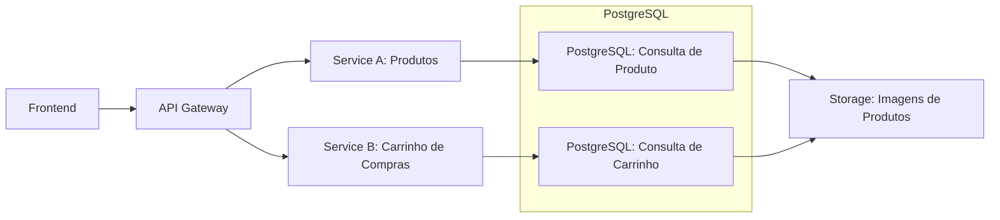

# Gestão Técnica e Arquitetura

## Estratégias Técnicas - Pt1

1. Exemplo Prático 1
   - Imagine que você esteja trabalhando em uma aplicação de e-commerce. De repente, a equipe recebe um pedido urgente para melhorar a performance de uma página de produto que carrega lentamente. Você tem duas opções:
     1. Solução Local
        - Analisar toda a arquitetura em si e otimizar a consulta ao banco de dados apenas para a página de produto.
        - Mudança controlada foca em parte específica do sistema.
        - A entrega rápida dentro do prazo garantindo a velocidade do time.

     2. Solução Global
        - Verificar múltiplas partes do sistema.
        - Atualizar a camada de dados para utilizar um cache global.
        - Aprimoramento de desempenho em todas as páginas do site.
        - Entrega mais demorada.

## <span style="color: #57ffb6ba">Otimizações</span> - <span style="color: #914dffff">Locais vs. Globais</span>



1. Olhando a arquitetura do sistema de maneira macro e é decidido aplicar uma modificação no ponto DB1 e a princípio vai resolver o problema, será mantido a velocidade e vai desbloquear para eu possa me dedicar a outras tarefas
   - Essa não é uma solução errada, porém, o que pode acontecer aqui é que para que a decisão seja tomada como mais propriedade, é necessário se perguntar outras coisas. Nesse quadro, não pode so olhar para a arquitetura do sistema, num vácuo e tomar essas decisões, até porque la na frente elas podem causar gargalos ainda maiores e nesse ponto é necessário saber:
     - Como que ta a equipe?
     - Temos tempo de fazer uma solução melhor?
     - Nos temos tempo para chegar e fazer uma refatoração?
     - Temos tempo para chegar aqui e realizar um [benchmark](#o-que-é-benchmark) e ver como essa solução se comporta?
     - Temos pessoas suficiente no meu time?
     - Eu consigo entregar isso no prazo estipulado?
     - Nós temos tempo para testar diferentes soluções?
   - Se caso uma das respostas para essas perguntas acima for não, essa solução seria a sua melhor abordagem, ou seja, fazer uma otimização local, para que possa desbloquear, para que possa ter tempo de trabalhar em soluções mais robustas no futuro.
   - Desta forma, estaria pensando em uma solução por momento <span style="color: #ff0000; font-weight: bold;">Local</span>

2. Mas, podemos ter o caso também, aonde agora, mudaram os requisitos, agora temos bastante tempo, estamos confortáveis, temos um time de sêniors no projeto, que vai poder sim avaliar as coisas de uma forma mais holistica, aonde a gente possa ver o sistema como um todo e também não queremos apenas trazer uma melhoria local, mas sim uma melhoria global para dentro do nosso sistema, resultando em uma experiência melhor para o usuário.
   - Para isso podemos mudar a arquitetura do sistema, criar uma camada de cache.

     ```mermaid
     flowchart LR
         B1["Frontend"]
         B2["API Gateway"]
         B3["Service A: Produtos"]
         B4[Service B: Carrinho de Compras]
         B5["Storage: Imagens de Produtos"]

         subgraph "Cache"
            C1["Redis Cache: Cache de Produtos"]
            C2["Redis Cache: Cache de Carrinho"]
         end

         subgraph "PostgreSQL"
           DB1["PostgreSQL: Consulta de Produto - Falha no Cache"]
           DB2["PostgreSQL: Consulta de Carrinho - Falha no Cache"]
         end

         B1 --> B2
         B2 --> B3
         B2 --> B4
         B3 --> C1
         B4 --> C2
         C1 --> DB1
         C2 --> DB2
         DB1 --> B5
         DB2 --> B5
     ```

   - Aonde, agora todo mundo que for fazer uma consulta dentro do banco de dados para esse tipo de consulta ou coisas parecidas, tanto no carrinho de compras, como na listagem de produtos, nós teriamos aqui uma solução um pouco mais robusta.
   - Porque isso é interessante?
     - Se estivermos em um cenário, aonde temos a possibilidade de fazer a solução melhor, ela é sempre mais recomendada, quando temos pessoas que vão ter a capacidade de desenvolver essa solução melhor, aonde a gente consiga testar, consiga encaixar dentro de um prazo e pense no produto em si, com ele sendo um [Future-proof](#o-que-é-future-proof), para que possamos ter uma competitividade melhor, para que possamos entregar algo melhor no mercado e tudo isso vai ser definido no bom senso do Tech Lead de entender em qual situação o software se encontra, aonde o time se encontra e dependendo disso, iremos escolher tanto uma situação mais simples quanto uma solução mais robusta.
     - Todas as soluções estão certas e o papel do Tech Lead é entender de forma estratégica, ou seja, usar o seu conhecimento técnico, de forma estratégica, para saber quando que iremos usar cada uma delas.

## <span style="color: #57ffb6ba">Não Existe </span><span style="color: #914dffff">Fórmula Mágica</span>

### O Equilíbrio é a 🔑

- Ao longo do processo de otimização e tomada de decisões técnicas, é importante entender que não há uma solução única que funcione para todos os cenários. A chave para o sucesso é balancear soluções locais e globais de acordo com as necessidades específicas do seu sistema e do momento que o projeto se encontra.

### Como decidir? 🤔

| Questionamento                                                                  | Solução Local | Solução Global |
| :------------------------------------------------------------------------------ | :------------ | :------------- |
| **Qual é o impacto a longo prazo da solução?**                                  | []            | []             |
| **Quão crítica é a performance para o sistema agora e no futuro?**              | []            | []             |
| **O problema é pontual ou recorrente?**                                         | []            | []             |
| **Quanto tempo a equipe tem para implementar a solução?**                       | []            | []             |
| **Qual será o custo de manutenção da solução escolhida?**                       | []            | []             |
| **A equipe tem experiência para resolver o problema de forma global ou local?** | []            | []             |
| **Quais são os riscos de não escalar a solução agora?**                         | []            | []             |
| **Quais são as depedências externas do sistema?**                               | []            | []             |
| **Quais são os requisitos de segurança e compilance?**                          | []            | []             |
| **Como a solução impacta a escalabilidade do sistema?**                         | []            | []             |

**Dica**: Ao responder essas perguntas, tente sempre pensar no produto em si, nos usuários e no negócio. Isso ajudará você a tomar decisões mais alinhadas com as necessidades do projeto.

## Estratégias Técnicas - Pt2

### Pontos importantes

1. Detalhar o escopo técnico para alinhar e esclarecer tarefas.
   - Buscar entender como o escopo técnico pode ser uma âncora que vai atrasar todo o time, quando é mal feito, como também pode ser um trampolim que vai impulsionar a velocidade do time quando esta bem feito.
2. Utilizar exemplos práticos para destacar a importância de um escopo bem definido.
3. Qual é a melhor forma de chegar lá?

### Exemplo Prático

- Supoha que você precisa criar uma API de checkout para um sistema de pagamento no nosso E-commerce.
  - #### O Que Não Fazer

    ```mermaid
    flowchart TD
      B1["Objetivo"]
      B2["Criar uma API para pagamento"]

      LC1{"Criar uma rota de checkout."}
      B3["Que rota?"]
      B4["Precisa de auth?"]

      LC2{"Validar os dados."}
      B5["Que data precisa ser validada?"]
      B6["Como validar?"]

      LC3{"Integrar com algum serviço de pagamento."}
      B7["Qual API de pagamento?"]
      B8["Como lidar com os erros?"]

      B1 --> B2

      B2 --> LC1
      LC1 --> |Ambiguidades| B3
      LC1 --> |Sem Detalhes| B4

      B2 --> LC2
      LC2 --> |Ambiguidades| B5
      LC2 --> |Ambiguidades| B6

      B2 --> LC3
      LC3 --> |Sem detalhes| B7
      LC3 --> |Ambiguous| B8

    ```

    - Pontos a se considerar
      1. Com relação a primeira parte: "Criar uma rota de checkout."
         - Ambiguidade
           - O Escopo não ficou muito bem definido
           - Foi gerado ambiguidade porque, provavelmente surge o questionamento:
             - Qual rota?
             - Poderia serm /checkout? ou /finish-checkout?
           - Não foi criado tarefas de forma determinísticas
           - Essa tarefa, por poder ser feita de várias formas diferentes, não foi especificado o resultado que é esperado com o resultado dessa tarefa em si, dificultando o fato de dizer quando ela estará pronta e também quem ira testar essa tarefa.
         - Falta de detalhamento
           - Meu checkout vai precisar de autenticação?
           - Como será feito?
           - Como lidar com novos usuários?
           - Se não tiver autenticado, não poderei comprar?
      2. Com relação a segunda parte: "Validar os dados."
         - Ambiguidades
           - Quais dados precisam ser validados?
           - Eu sei como vou validar eles?
             - Será com um e-mail?
             - Será com uma biblioteca?
             - Validar com JS/TS?
      3. Com relação a terceira parte: "Integrar com algum serviço de pagamento."
         - Falta de detalhamento
           - Qual a API que vai ser utilziada?
           - O que eu posso fazer, no momento que o usuário fizer algo que não estiver detalhado?
         - Ambiguidades
           - Como lidar com os erros durante o processo?
      - Todos esses pontos/questionamentos podem se tornar um atraso, podem se tornar um retrabalho e esse retrabalho pode gerar fricção no time, com isso terá desenvolvedores mais frustrados e os prazos também em decorrer disso, ficarão mais apertados, porque é díficil chegar desta forma em uma completude.
    * Resumindo: O que não fazer?
      - Ambiguidades:
        - O que significa "Validar os dados?"
        - Como Deve ser feito?
      - Falta de detalhes:
        - Não há clareza sobre a autentição ou o serviço de pagamento
      - Incerteza para o time:
        - O time pode interpretar de formas diferentes as tarefas e as prioridades.

  - #### O Que Fazer

    ```mermaid
    flowchart TD
      B1["Início"]
      B2["Receber requisição POST /checkout"]
      BF["Fim"]

      LC{"Autenticação OAuth2"}
      B3["Retornar status 401"]
      B4["Validar dados com Joi"]

      B5["Retornar status 400"]
      B6["Processar pagamento com Stripe API"]

      B7["Retornar status 400"]
      B8["Gerar recibo"]

      B9["Enviar recibo para o usuário"]
      B10["Retornar status 200 com confirmação"]

      B1 --> B2

      B2 --> LC
      LC --> |Falha| B3
      LC --> |Sucesso| B4
      B3 --> BF

      B4 --> |Inválido| B5
      B4 --> |Válido| B6
      B5 --> BF

      B6 --> |Falha| B7
      B6 --> |Sucesso| B8
      B7 --> BF

      B8 --> B9
      B9 --> B10
      B10 --> BF

    ```

    - Pontos a se considerar
      1. Sempre levar em consideração os caminhos felizes e os caminhos de falha, para que na sua validação de espaço para testes e dar espaço para todos os 'corner cases', ou seja, todas as exceções.
      2. Com base no diagrama acima, quando formos aplicar essa transição para o Jira (ou qualquer ferramenta de gerenciamento de tarefa), ficará muito mais fácil de repassar para um PM ou até mesmo o próprio Tech Lead criar os tickets técnicos, sabendo validar o que esta sendo tratado no momento.
         - Exemplo: Utilizando a Stripe API, como mencionado acima, já sabemos que é algo que vem de uma third party, que e muitas vezes uma empresa ou algo que não temos controle algum sobre o que pode acontecer, que é uma lib que vai ser importada no nosso sistema e sendo assim, pensando já em testes, já pensamos em questão de mocks de uma api de pagamentos, para que eu possa testar, porém, isso so é claro para mim e pro meu time, quando temos essas definições e utiliza essas estratégias técnicas, para definir um escopo muito bem claro pra o meu time e assim poder alavancar o mesmo em questão de alinhamento, produtividade e entrega.
    * Resumindo: O que fazer?
      - Clareza: Todos sabem exatamente o que é necessário.
      - Dependências bem definidas: A integração com o Stripe e a autenticação com OAuth2 estão claras.
      - Tarefas divididas e sequenciais: Cada etapa é bem definida.

## <span style="color: #57ffb6ba">Escopo técnico para </span><span style="color: #914dffff">alavancar o time.</span>

- Buscando ou definindo escopos mais claros, uma definição mais clara, traz uma certeza maior para o time, diminui a fricção, aumenta a velocidade e garante que será entregue algo com valor, com testes, algo muito bem dividido, muito bem claro para todos e isso no fim vai alavancar a sua própria carreira e a carreira de todo time.
  <br />
  <br />

## <span style="color: #07fffbff">Lições </span>

- Para concluir, o detalhamento do escopo técnico é crucial para garantir que todos no time estejam alinhados e que a execução do projeto seja eficiente.
  <br />
  <br />

## <span style="color: #1cff07ff">Como chegar? </span>

| Checklist de Escopo Técnico                              | Feito? (☑️/✖️) |
| :------------------------------------------------------- | :------------- |
| O objetivo do projeto está claramente definido?          | ☑️             |
| As tarefas foram divididas em subtarefas menores?        | ☑️             |
| Todos os requisitos técnicos foram listados e definidos? | ☑️             |
| Os critérios de sucesso estão claros?                    | ☑️             |
| As tecnologias necessárias estão definidas e alinhadas?  | ☑️             |
| Existem estimativas realistas de tempo para cada tarefa? | ☑️             |
| A documentação esta planejada?                           | ✖️             |
| Existe um plano de testes claro?                         | ☑️             |
| Os riscos técnicos foram identificados?                  | ☑️             |
| O time esta alinhado sobre as prioridades?               | ☑️             |
| O projeto foi projetado com escalabilidade em mente?     | ☑️             |
| Existe um plano de manutenção para o futuro?             | ✖️             |

## <span style="color: #9e83ffff">Glossário </span>

### O que é Benchmark?

Na prática, o benchmark consiste em medir o desempenho de um sistema, produto, software ou processo usando **testes padronizados** (chamados de benchmarks). O objetivo é comparar esses resultados com:

1. **Outros concorrentes ou modelos** (para saber qual é superior em determinado quesito).
2. **Versões anteriores** (para avaliar se uma atualização melhorou ou piorou o desempenho)
3. **Padrões da indústria** (para verificar se o produto atinge o nível esperado pelo mercado)

### O que é Future-proof?

No contexto de tecnologia, engenharia e negócios, algo que é future-proof é projetado ou construído de tal forma que não se tornará obsoleto rapidamente, mesmo que o mercado mude, novas tecnologias apareçam ou os requisitos comecem a mudar drasticamente.

- Exemplos:
  1. Em software/Desenvolvimento: Escrever um código limpo, modular e escalável que aceite novas integrações no futuro sem precisar ser reescrito dom zero.
  2. Em Hardware (ex.: Placas de vídeos ou consoles): Comprar um componente que tenha potência de sobra para rodar softwares que ainda vão ser lançados nos próximos anos.
  3. Em Arquitetura/Negócios: Criar processos empresariais flexíveis o suficiente para sobreviver a crises ou a grandes reviravoltas digitais (como a inteligência artificial).
