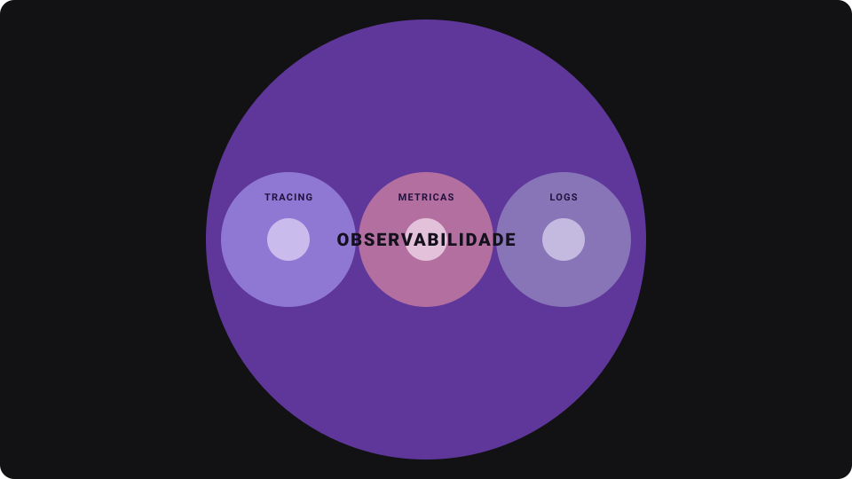

# Observabilidade e Monitoramento

1. Conceitos fundamentais
2. Por Que Observabilidade e Monitoramento São Importantes para Teach Leads?
3. Como incluir Monitoramento e Observabilidade

## Observabilidade / Monitoramento

### Indicadores (para saber se o sistema esta dando conta das requisições ou não)

- Alertas de CPU alta
- Disponibilidade de endpoints
- Tempo de resposta

  Todos esses indicadores juntos, criam uma métrica:

  

- Após definir as métricas da aplicação, eu posso fazer o monitoramento das métricas
  - Monitoramento, pensa em monitorar uma métrica, ou um fator especifico para ficar analisando.

- Ás métricas por si só, não são tão úteis assim.
  - Pois, o interessante seria combinar outras técnicas, para assim, conseguir identificar os erros, os gargalos e possíveis pontos de falha na nossa aplicação.
  - É muito comum, quando as aplicações vão ficando maiores,a gente se preocupar com **logs**.
    - logs e métricas andam muito lado a lado
- Temos a parte de tracing também, que darão informações importantes como e onde o erro aconteceu

- Juntando tudo isso, teremos o que chamamos de **observabilidade**:

- Monitoramento basicamente se encontra inserido em observabilidade, porque observabilidade é um termo meio que guarda-chuva que encapsula tudo isso
- Todo monitoramento faz parte da observabilidade, mas observabilidade é algo muito maior do que apenas monitoramento.

## A importância  para Tech Leads

- Detecção de falhar rapidamente
- Prevenção de problemas futuros
- Otimização contínua
- Melhor tomada de decisão

## Exemplo Prático

### Monitorar sistema de e-commerce:

    - Frontend
    - Backend
    - API Gateway

    - ### O Que Não Fazer
      - Apenas logs locais ou de logs isolados de cada serviço
      - Zero métricas de desempenho
      - Coletar dados de monitoramento apenas após as falhas
    - ### O Que Fazer
      - Configurar alertas de métricas chave como latência e uso de recursos.
      - Centralize os logs para que você possa ter visibilidade completa.
      - Implemente tracing distribuído para entender como as requisições estão fluindo entre os serviços.

    - Ferramentas
      - Grafana

- Liçoes
  - Invista em tempo e recursos na implementação de monitoramento e observalidade desde ínicio.
  - Como Tech Lead é sua responsabilidade garantir que o sistema seja escalável e fácil de manter.
  - Monitoramento não é apenas para quando as coisas dão errado, mas para entender como melhorar continuamente.

## Ferramentas  Técnicas

1. Prometheus & Grafana:
   - Prometheus coleta métricas e Grafana exibe essas métricas de maneira visual.
   - Use para monitorar métricas de sistemas como latência, taxa de erro e uso de recursos.
2. ELK Stack (Elasticsearch, Logstash, Kibana):
   - Elasticsearch para indexação de logs, logstash para processá-los e kibana para visualizá-los.
   - Ideal para cenralizar e buscar logs de todos os serviços.
3. Jaeger e Zipkin (Tracing Distribuído):
   - Ferramentas para rastrear as requisições entre microserviços.
   - Crucial para entender o tempo de resposta e onde as requisições estão se acumulando.
