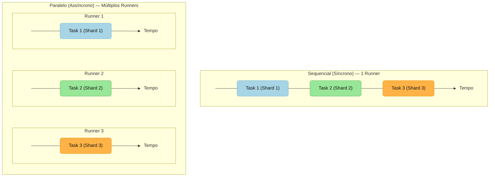

# A primeira maneira - Os princípios do Fluxo - Parte 1

## Introdução a Primeira Maneira

- Geralmente temos um fluxo de trabalho da esquerda para direita.
- Desenvolvimento -> Operações.
- Objetivo:
  - Otimizar o fluxo visando o objetivo da empresa em vez de objetivo dos times.
  - Diminuir o tempo exigido para implementar mudanças em produção.
  - Aumentar a confiabilidade e a qualidade das entregas.
- Como:
  - Tornando o trabalho visível.
  - Reduzindo o tamanho das entregas em pequenos lotes.
  - Reduzindo o intervalo de trabalho.
  - Adicionando processos de qualidade para evitar que defeitos passem de um fluxo pro outro.

## Focos de atuação

- [A primeira maneira - Os princípios do Fluxo - Parte 1](#a-primeira-maneira---os-princípios-do-fluxo---parte-1)
  - [Introdução a Primeira Maneira](#introdução-a-primeira-maneira)
  - [Focos de atuação](#focos-de-atuação)
    - [1. Tornar nosso trabalho visível](#1-tornar-nosso-trabalho-visível)
    - [2. Controle de WIP (Work In Progress)](#2-controle-de-wip-work-in-progress)
    - [3. Reduzir o tamanho da entrega](#3-reduzir-o-tamanho-da-entrega)
    - [4. Reduzir o número de transferências](#4-reduzir-o-número-de-transferências)
    - [5. Identificar e elevar nossas restrições](#5-identificar-e-elevar-nossas-restrições)
      - [Paralelização de Testes no CI/CD](#paralelização-de-testes-no-cicd)
        - [Como Funciona a Paralelização na Prática](#como-funciona-a-paralelização-na-prática)
        - [Principais Benefícios](#principais-benefícios)

---

### 1. Tornar nosso trabalho visível

- O que nosso time está realmente fazendo?
- Qual time está responsável por determinada entrega?
- Quanto tempo esta demanda está aberta?
- O que impesse essa demanda de ser entregue?
  - Falta de conhecimento do time
    - de infraestrutura?
    - de operações?
    - de desenvolvimento?
  - É algum impediditivo?
  - Alguma repriorização?
- Nosso contexto de trabalho:
  - Nosso trabalho em tecnologia é praticamente invisível.
    - Precisamos de algo sistêmico e não só de um sistema
    - É preciso que as pessoas sigam esse processo
    - Aqui tem a importância realmente, de seguir os processos ágeis, de usar um Kanban, um Scrum, uma metodologia ágil para estar ajudando a gente.
  - Mudamos o contexto rapidamente.
  - Repassamos demandas para outros times com um clique.
  - Tarefas podem ser solicitadas com informações incompletar e/ou com problemas.
  - Se não tornar todas as ações visuais, não saberemos onde estão nossos gargalos (restrições)
- Aqui entra a importância do ágil:
  - Kanban.
  - Scrum (sprints)
- Resultado:
  - Melhora nosso planejamento e gerenciamento.
  - Ajuda a encontrar o que está nos impedindo de avançar.
  - Permite medir o tempo de execução (desde quando o card foi criado)
  - Permite identificar dependências e definir priorização entre os times.
    - Algumas empresas adotam a planning integrada que reune líderes de cada time.
    - Dependências são compatilhadas e priorizações são definidas.

---

### 2. Controle de WIP (Work In Progress)

**"Pare de começar e comece a terminar"**

- Nosso trabalho é dinâmico, principalmente quem atua com serviços compartilhados.
- Em muitas situações nossa priorização é alterada devido ao Top Down.
- Interrupções e mudanças de contexto são invisíveis para quase todo mundo.
- Mudança de contexto é altamente prejudicial para produtividade.

- Resultado do controle de WIP:
  - Maior gerenciamento.
  - Permite controlar melhor o tempo de execução.
  - Permite descobrir o que esta impedindo o avanço das atividades.
- Ao invês de começar um novo trabalho.
- Busque o que está causando o atrado.
- Criar planos para corrigir o problema.
  - Exemplo:
    - Limitar o estágio de WIP a 3 tarefas
    - Não pode começar nenhuma outra tarefa, a não ser que termine alguma dessas tarefas.
    - Isso está muito ligado com gestão de capacidade.
    - Quem trabalha diretamente com metodologias ágeis, trabalhando com kanban, trabalhando com sprint principalmente, nos temos no <abbr title="É uma técnica colaborativa e lúdica usada em metodologias ágeis (como Scrum) para estimar o esforço, a complexidade e o risco de histórias de usuário em um backlog.">Poker Planning</abbr>, aonde conseguimnos definir os pontos que aquela tarefa tem para que a gente consiga medir a nossa capacidade e controlar o nosso WIP.
    - Não podemos criar uma nova ação, se a gente passou o nosso limite de WIP.

### 3. Reduzir o tamanho da entrega

- Muito comentado dentro da Engenharia de Software
- Vamos supor que precisamos montar 10 caixas para armazenar alguns itens iguais.
- O processo inclui:
  - Cortar os moldes de papelão.
  - Dobrar o papelão.
  - Colar cada caixa.
  - Guardar o item

- Produção em massa:
  - Cortar 10 moldes de papelão.
  - Dobrar as 10 caixas.
  - Colar as 10 caixas.
  - guardar o item.

**E se o tamanho dos moldes não for suficiente para armazenar o item?**

- Temos que começar tudo de novo.
- Além de aumentar o tempo de execução.
  - O que era pra ser rápido, já não será tão rápido.
  - resultando em retrabalho.
- Problemas na qualidade.
- O cliente só percebe valor, muito tempo depois.

- Fluxo de uma peça:
  - corta 1 molde de papelão.
  - Dobra 1 caixa.
  - Colar 1 caixa.
  - Guardar 1 item.

**Reduz o tempo de entrega.**

- A primeira entrega acontece muito mais rápipo.
- O cliente rapidamente percebe valor.
- Qualquer problema durante o processo é identificado quase que imediatamente.

- No mundo da tecnologia, lotes grandes significam:
  - Nova versão de um software demora meses ou até mesmo anos para serem entregues.
- Resultado:
  - Rápida detecção de problemas.
  - Menor tempo de execução (Tempo para entregar o pedido para o cliente.).
  - Redução no WIP.
  - Evita retrabalho.
    - um dos pontos mais importantes
    - Porque causa disperdicio de tempo, de recurso e de dinheiro.

  - ```mermaid
    flowchart LR
        subgraph TimeExec ["Tempo de Execução"]
            C[CCCCCCCCCC]
        end
        TimeExec -.- NotaExec["Demora 'x' tempos"]

        subgraph Queue ["Fila"]
            D[DDDDDDDDDD]
        end
        Queue -.- NotaQueue["Demora 'n' tempos"]

        TimeExec --- Queue

        classDef nota fill:#fff8c5,stroke:#d4a72c,stroke-dasharray: 5 5,color:#333
        class NotaExec,NotaQueue nota
    ```

    ```mermaid
    flowchart LR
        subgraph batch1 ["Tempo de execução 1"]
            L1[CDCG]
        end

        subgraph batch2 ["Tempo de execução 2"]
            L2[CDCG]
        end

        batch1 --- batch2

    ```

    - No primeiro caso, se quebrasse o processo durante o tempo de execução, não existira nenhuma entrega.
    - No segundo caso, como estamos trabalhando com lotes menores, em virtude disso tempo de execução e fila ficam menores, caso ocorrer algum erro, o tempo de execução foi menor, o retrabalho será menor, porém, o cliente pode receber o item, mesmo que não seja a entrega final.

### 4. Reduzir o número de transferências

- Dentro do ciclo de desenvolvimento de software, além do código temos diversas atividades que precisam ser executadas.
  - Criação de um novo recurso na Cloud.
  - Criar usuário e/ou dar permissão de um recurso ou banco de dados.
  - Provisionar nova arquitetura.
  - Entre outros.
- Transferência significa que seu time precisa de uma ação de outro time para conseguir concluir uma demanda.
  - Não adianta fazer o código, se você não conseguir 'puxar' uma senha que está lá na AWS.
  - Não adianta fazer o código em sua máquina, se você não tem usuário e senha para se conectar no banco de dados que vai la para o ambiente de prod.
- Exige:
  - Comunicação.
  - Repriorização de outras áreas.
    - O simples criar um usuário e senha no banco, pode ser muito mais complexo, que envolve quem vai validar, quem realmente pode acessar esse banco
    - Validar qual que é o padrão do usuário que vai ser criado.
    - Existem várias nuances que precisam ser tratadas.
  - Documentação.
    - É necessário escrever uma documentação, para apresentar para outra área, para poder convencer a mesma e solicitar que seja criado algo, seguindo alguns padrões específicos, por exemplo, para não ficar desorganizado, resultando em uma bagunça.
  - E-mails, reuniões, ligações e etc.
  - Agendamento.
    - Apesar do time ter repriorizado, não pode parar aquilo que já estava fazendo ou se parar , vai entrar na parte do TopDown, que já foi comentado aqui
    - Por isso precisa do agendamento, aonde essa determinada tarefa vai ser executada em tal dia, tal horário e assim, estaremos na fila, aguardando a execução.
- Cada etapa entra em uma fila e o trabalho irá aguardar a sua execução.
- Gerando grande dificuldade em gerir o cronograma de entrega.
  - Pois, nossa área tem um cronograma de entrega, uma outra área tem outro cronograma de entrega e se ficarmos passando demanda para lá, vai impactar o cronograma deles e se eles não fizerem o nosso, vai impactar o nosso, sendo assim, como que a gente vai fazer esse gerenciamento?
- Para reduzir o número de transferências precisamos:
  - Automatizar partes significativas do trabalho.
  - Prover uma estrutura que nossos clientes internos possa utilizar melhor os recursos da infraestrutura.

**Resultado:**

- Aumenta a velocidade do fluxo de trabalho.
- Reduz o tempo de trabalho na fila aguardando execução.

### 5. Identificar e elevar nossas restrições

- Esse conceito vem da **Teoria das Restrições (ToC - Theory of Constraints)**, de **Eliyahu Goldratt**, que afirma que **um sistema sempre tem pelo menos uma restrição que limita sua performance geral**. Se não fosse assim, o sistema rodaria infinitamente rápido.
- O que é uma restrição no contexto de DevOps?
  - Qualquer fator que limita, bloqueia ou desacelera o fluxo de trabalho.
- Se identificarmos e eliminarmos nossas restrições teremos um fluxo de trabalho muito melhor.
- Aplicar melhorias antes ou depois da nossa principal restrição não traz nenhum resultado:
  - O trabalho vai continua se acumulando ou aguardando devido ao gargalo.

- #### Como elevar as restrições de DevOps?
  - Identificar a restrição (O gargalo):
    - Onde o fluxo de desenvolvimento ou entrega está sendo mais impactado?
    - Exemplo: Builds lentos, aprovações manuais, filas de tickets no suporte.
  - Explorar a restrição (Aproveitar ao máximo o gargalo atual):
    - Melhorar processos existentes antes de aumentar a capacidade.
      - Seja com mais recursos, com mais infraestrutura..
    - Exemplo: <abbr title="A expressão paralelizar testes para reduzir o tempo de CI/CD refere-se à prática de dividir uma grande suíte de testes automatizados e executá-los simultaneamente em múltiplos ambientes, nós de computação ou containers, em vez de rodá-los um após o outro (de forma sequencial) em uma única máquina.">Paralelizar testes para reduzir o tempo de CI/CD</abbr>.
  - Elevar a restrição (Aumentar sua capacidade):
    - Melhorar ou substituir a parte do sistema que limita o fluxo.
    - Criar automações, Automatizar deploys, escalar horizontalmente um serviço, investir em infra cloud mais eficiente.
  - Evitar que outra parte do sistema vire o novo gargalo:
    - Cada melhoria pode revelar um novo ponto fraco.
    - Exemplo: Melhorou no deploy? Agora os testes são o novo gargalo.
  - Repetir o processo continuamente:
    - Identificamos a restrição:
      - Explorei, elevei, evitei que outra parte do processo vire um gargalo, agora retornamos ao passo 1 e vou lá identificar uma nova restrição.
    - DevOps é sobre melhoria contínua.

---

#### Paralelização de Testes no CI/CD

Para ilustrar a diferença entre executar uma suíte de testes de forma **sequencial (síncrona)** em um único runner versus **paralela (assíncrona)** distribuída em múltiplos runners:



##### Como Funciona a Paralelização na Prática

A estratégia costuma envolver duas abordagens principais:

1. **Test Sharding (Divisão de Carga):** A suíte total de testes é fatiada em partes iguais (por exemplo, 4 shards). Se você tem 1.000 testes, cada um dos 4 runners de CI executa 250 testes ao mesmo tempo.
2. **Matrix Builds / Múltiplos Jobs:** Ferramentas de CI/CD (como GitHub Actions, GitLab CI ou Jenkins) permitem declarar uma matriz de execução, disparando instâncias isoladas em paralelo para diferentes módulos, navegadores ou suítes de teste.

##### Principais Benefícios

1. **Feedback Acelerado:** Reduz o tempo de pipeline de dezenas de minutos para poucos minutos, permitindo que merges e deploys aconteçam com agilidade.
2. **Escalabilidade:** Permite que a equipe continue escrevendo novos testes sem medo de tornar o processo de CI/CD inviável por lentidão.
3. **Detecção Precoce de Gargalos:** Ajuda a identificar testes lentos ou instáveis (_flaky tests_) que poluem o pipeline.
