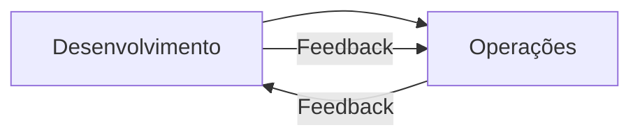
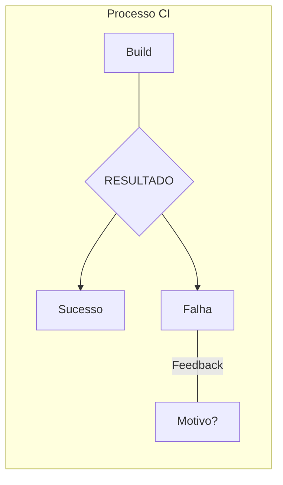
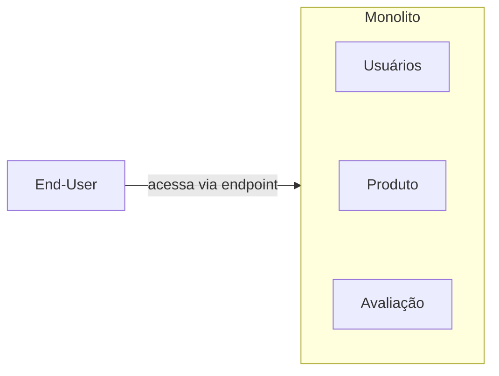
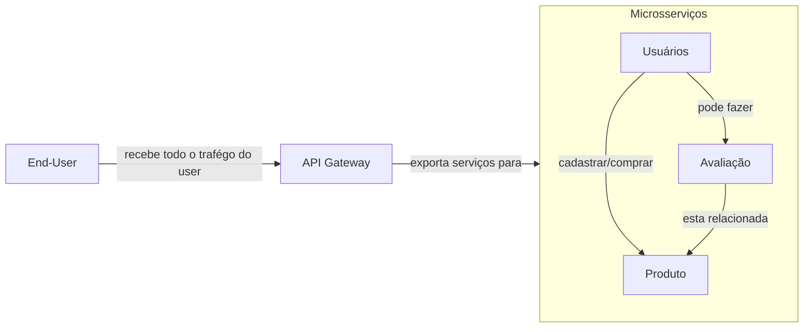

# A Segunda Maneira - Os princípios do Feedback

## O que vismos até agora?

- **Primeira maneira**: Fluxo de trabalho rápdio da esquerda para direita.
- **Segunda maneira**: Feedback rápido e constante da direita para a esquerda em todos os estágios do fluxo de valor.

## Objetivo da segunda maneira

- Criar um sistema de trabalho mais seguro e resiliente.
- Geralmente detectamos e corrigimos problemas em uma aplicação quando um incidente está acontecendo.
  - Isso não pode estar acontecendo em um ambiente aonde a gente procura ser escalável, aonde a gente quer entregar valor rápido para o cliente, aonde a gente quer ajudar nossa empresa a agregar mais valor.

## Transições de Monólitos para Microsserviços

- **Monólitos**: São sistemas grandes e únicos aonde qualquer alteração pode impactar toda a aplicação.

---

- **Microserviços**: Sistemas divididos em pequenas partes independentes, cada uma com sua responsabilidade.

---

- A mudança ocorreu devido à necessidade de maior **flexibilidade**, **escalabilidade** e **experimentação** no desenvolvimento de software.

---

## Sistemas complexos

- Uma característica comum de um sistema complexo é que ele desafia a capacidade de uma pessoa ver e entender como todas as partes funcionam.
- Principalmente detectar onde e qual é o problema.

## 4 ações para trabalhar com sistemas complexos

- [A Segunda Maneira - Os princípios do Feedback](#a-segunda-maneira---os-princípios-do-feedback)
  - [O que vismos até agora?](#o-que-vismos-até-agora)
  - [Objetivo da segunda maneira](#objetivo-da-segunda-maneira)
  - [Transições de Monólitos para Microsserviços](#transições-de-monólitos-para-microsserviços)
  - [Sistemas complexos](#sistemas-complexos)
  - [4 ações para trabalhar com sistemas complexos](#4-ações-para-trabalhar-com-sistemas-complexos)
  - [Ver quando os problemas ocorrem](#ver-quando-os-problemas-ocorrem)
  - [Aglomerar e resolver problemas para construir novo conhecimento](#aglomerar-e-resolver-problemas-para-construir-novo-conhecimento)
  - [Manter a qualidade mais próxima da fonte](#manter-a-qualidade-mais-próxima-da-fonte)

## Ver quando os problemas ocorrem

- No contexto de DevOps, observabilidade é a disciplina mais conhecida, porém não se resume a isso.
- Feedback deve ser em todos os estágios do ciclo de desenvolvimento.
  - Gerência de produtos.
  - Desenvolvimento.
  - QA.
  - InfoSec.
  - Operações.
- Devemos criar também a telemetria para que possamos ver como todos os componentes de nosso sistema estão operando.
  - Criar métricas para que a gente consiga observar como os componentes do nosso sistema estão operando.
- Resultado:
  - Detecção e recuperação rápida de problemas.
  - Obter uma base de conhecimento para evitar problemas no futuro.
    - Não adianta saber que um problema existe, armazenar ele na minha base, ter um débito técnico registrado e no fim não realizar nenhum tipo de autuação. È preciso autuar para corrigir isso.

## Aglomerar e resolver problemas para construir novo conhecimento

- Detectar não é o suficiente
- Devemos aglomerar (mobilizar pessoas necessárias) para resolver os problemas.
- Tem como objetivo resolver problemas antes que se espalhem, por exemplo, afetem mais usuários.
- Além disso transformar ações em débitos técnicos para que possam ser resolvidos definitivamente para que não aconteçam novamente ao futuro.

- ### A corda de Andon da Toyota
  - Em uma das fábricas da toyota, existiu/existe uma corda que todo funcionário é treinado para puxar quando algo dá errado.
  - O líder da equipe é acionado imediatamente para resolver o problema.
  - Caso não seja possível resolver em um tempo pré-determinado, toda a linha de produção para, a fim de mobilizar todas as pessoas necessárias para resolver o problema.
  - Em vez de contornar o problema ou agendar uma correção "para quando tiver tempo", o problema é resolvido imediatamente.
    - mas o que nos deparamos , é um bug e preciso corrigir o mesmo.
      - Do lado de operações, o que eu posso fazer para quando eu fizer um deploy em produção e ele so ser ativado efetivamente depois de um determinado período de tempo, para garantir que as requisições estejam sendo recebidas, estão sendo processadas, algo nesse sentido.

- ### A importância da aglomeração
  - A aglomeração é necessária pelos seguintes motivos:
    - Impede que o problema seja transferido para o próximo estágio.
      - Evitando um maior custo e esforço para resolução e aumento da dívida técnica.
    - Impede que um novo trabalho seja iniciado, trazendo consigo o mesmo ou novos erros.
    - Possibilita o aprendizado, evita a perda de informações importantes devido ao esquecimento ou mudança de circunstâncias.
      - A medida que o tempo passa fica impossível reproduzir o erro de quando o problema ocorreu.
        - Alguns fatores tecnológicos também impedem a gente de reproduzir o mesmo erro quando o problema ocorre.
        - Exemplo:
          - Fiz um deploy e depois o banco trocou, a api mudou, alguém já fez deploy por cima...
          - Sem contar que para reproduzir o erro, não pode ser em produção, então será necessário subir outro ambiente, esse ambiente não vai estar equalizado com o de produção e isso vai resultar na não geração do erro.

- ### A corda de Andon no fluxo de valor tecnológico
  - Devemos criar uma cultura que encoraja as pessoas a informar quando algo da errado.
  - Mesmo que a pessoas foi a que causou o problema.
  - Isso fornece um feedback rápido, permitindo isolar e diagnosticar rapidamente o problema evitando que se complique com o passar do tempo.
  - Essa cultura não deve procurar culpados, mas sim incentivar o feedback, construção de conhecimento e evitar que o problema se repita.

## Manter a qualidade mais próxima da fonte
