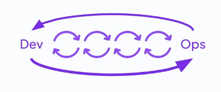

# A terceira maneira - Os princípios do Aprendizado Contínuo e Experimentação

## O que vimos até agora

- **Primeira maneira**: Fluxo de trabalho rápido da esquerda para direita.
- **Segunda maneira**: Feedback rápido e constante da direita para a esquerda em todos os estágios do fluxo de valor.
- **Terceira maneira**: Foco na criação de uma cultura de aprendizado contínuo e experimentação.

  

## Nosso objetivo como DevOps

- Criar uma cultura de alta confiança, reforçando a importância do aprendizado diário e que muitas vezes será necessário assumir riscos.
  - Ao falar de cultura de confiança, podemos ter a seguinte visão como exemplo:
    - Vamos fazer o deploy, não precisamos de gemud, conseguimos fazer sem ter impacto no ambiente de prod e sem causar uma indisponibilidade para o cliente final.
    - Então mesmo com a cultura DevOps implementada, muitas empresas ainda não conseguem ter essa cultura de auto-confiança e acaba tendo alguns processos que amarram todo aquilo que acabamos configurando e criando de solução para deixar tudo automatizado.
- Isso é um dos princípios que permite criar um constante conhecimento individual que é, então transformado em conhecimento da equipe e da empresa.

  
  - O Secret Provider se conecta com o Driver CSI
  - O Driver CSI(plugin do kubernets) tem um plugin para o nosso provedor de Cloud e esse plugin faz a conexão com o Secret Manager
  - Quando fazemos o Deploy e temos esse Secret Provider criado, será criado uma Secret, dentro do nosso cluster Kubernetes, pegando as credenciais que tem ali no Secret Manager
  - Temo o POD que está associado, fazendo a leitura da Secret

  - ## O que estava acontecendo?
    - Muitas vezes quando o pessoal estava criando uma nova secret na AWS, ele não estava sincronizando automaticamente, ou seja, teriamos que matar o POD, matar a secret, para que ai sim , o secret provider entendesse que teria algo novo na AWS, preciso ir la buscar e configurar.
    - Após tantas requisições de atendimento que foram acontecendo, foi verificado que só era necessário habilitar a opção de Rotação de Secret, então, o próprio Secret Provider ali, de tempos em tempos, fazia a leitura no secret manager para saber se tinha algum tipo de alteração e com isso então, conseguiamos ter isso atualizado sem ter que reiniciar os PODS, sem ter que matar secrets, sem precisar fazer uma intervenção humana.
    - Então, com tudo isso, pegando os problemas, o conhecimento ficou com usuário no caso, foi repassado para a corporação e conseguimos chegar em uma causa raiz e uma solução definitiva.

- Necessário utilizar uma abordagem científica para melhorar o desenvolvimento dos produtos, aprendendo com nossos sucessos e nossas falhas.
- Mapeando ideias que não funcionam e reforçando as que funcionam.

## A base do funcionamento

- Reservando tempo para aplicar melhorias no trabalho diário.
  - Em muitas empresas, nos temos hoje:
    - Um profissional de DevOps dedicado a projetos
      - Consegue ficar trabalhando na melhoria diária, mas se tiver uma rotação desse time, conseguimos com que todos estejam sempre trabalhando com algo novo ou sempre pegando sua experiência e compartilhando com todo mundo.
    - Um profissional de DevOps dedicado a sustentação
- Introduzindo maneira de degradar nossas aplicações para forçar a melhoria contínua.
- Simulando falhas sob condições controladas para aumentar a resiliência.

## Iniciativas que possibilitam a terceira maneira

- Possibilitar o aprendizado organizacional.
  - Deixar que todo mundo fale, que todo mundo apresente..
- Institucionalizar a melhoria do trabalho diário.
  - Ter uma notação de débito técnico que a gente pode melhorar ou que a gente pode trazer de algo novo para dentro do ambiente e principalmente transformar descobertas locais em melhorias globais.
- Injetar padrões de resiliência em nosso trabalho diário.
  - Como que eu posso ser resiliente?
    - sempre pensando em construir algo que a gente consiga controlar da melhor maneira e consiga ser tolerante a falhas.
- Líderes reforçam a cultura de aprendizado.
  - Buscar ter uma seção de conhecimento, aonde cada um vai compartilhando, criando uma apresentação e compartilha o que aprendeu, o que fez e vai todo mundo, não so dependendo só da documentação e sim dependendo do aprendizado compartilhado de outros membros da equipe.

  - ### Possibilitar o aprendizado organizacional
    - O cenário comum:
      - Um incidente ocorre e impacta o cliente final.
      - A causa é imediatamente atribuída a erro humano.
      - A gerência identifica um culpado e sugere uma punição.
      - Novos processos e aprovações são criados para evitar que o erro ocorra novamente.
    - Consequências:
      - Funcionários evitam relatar problemas por medo de punição.
      - Problemas não são resolvidos na causa raiz, apenas contornados.
      - A empresa desenvolve uma cultura do medo, onde falhas são escondidas.
      - Pequenos problemas se acumulam e geram grandes desastres no futuro.
    - Exemplos:
      - em 2017, um engenheiro da AWS executou um comando errado que derrubou metade dos serviços. Em vez de punir, a empresa revisou seus processos para evitar que o erro ocorresse novamente.
      - No caso do Boeing 737 MAX, falhas foram ocultadas e o problema só foi revelado após dois grandes acidentes.

## Os 3 tipos de cultura pelo Dr. Westrum

- **Organizações patológicas (tóxica)**
  - Baseado no medo e ameaças. Informações são econdidas, distorcidas ou manipuladas para autopreservação. Erros são vistos como fraqueza e podem levar a punição.
- **Organizações burocráticaas**
  - Processos e regras rígidas dominam a empresa. Áreas individuais protegem seus "territórios". Erros geram julgamento, podendo resultar em punição, perdão ou apenas justiça sem aprendizado real.
- **Organizações produtivas(geradora)**
  - Comunicação aberta e compartilhamento de informações são incetivados. Falhas são tratadas como oportunidades de aprendizado. Equipes trabalham juntas para encontrar soluções em vez de culpar indivíduos.

- Para que o DevOps funcione de verdade, precisamos migrar de culturas patológicas e burocráticas para culturas positivas, onde o aprendizado contínuo e a colaboração são incentivados.
