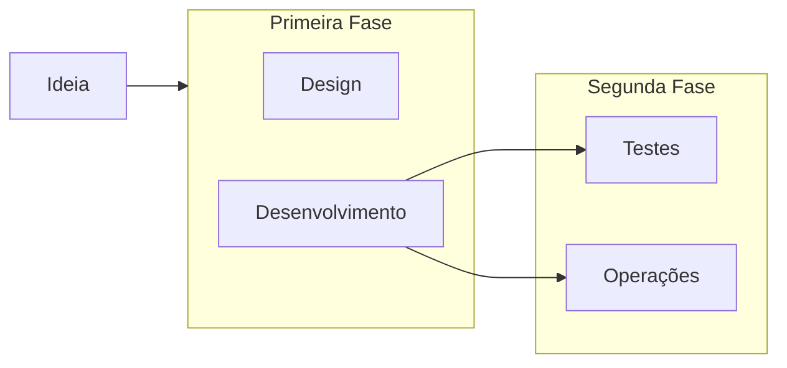

# Tempo de execução e Tempo de Processo

## O tempo de execução e implementação

- A primeira fase consiste em design e desenvolvimento.
- A segunda fase consite em testes e operações.
- **O objetivo é fazer com que o design e desenvolvimento sejam executados em paralelo com testes e operações, criando assim, um fluxo rápido de entrega de valor.**
- Ponto importante: Entregas em pequenos lotes têm maior chance de êxito.



## Principais métricas de acompanhamento de fluxo

- Tempo de execução
  - Tempo entre o pedido e a entrega.
  - Quando a atividade é criada no board por exemplo.
  - O tempo entre o aceite e o prepara é chamado de Fila.

- Tempo de processamento
  - Tempo entre o ínicio de desenvolvimento e a entre em produção.
  - Tempo de processamento basicamente é o tempo entre o preparo e a entrega.
  - Quando o desenvolvedor inicia o desenvolvimento do código por exemplo.

- Percentual de conclusão e precisão (%C/P)
  - Reflete a qualidade de saída de cada etapa do processo.
  - Exemplo: Dev repassou o código para time de QA testar, porém, cadê as DOCS? os requisitos funcionais? O dev deveria ter enviado junto.
  - Sem essa informação o QA não consegue trabalhar, sendo assim, volta para o DEV, para que seja repassado essa informação e assim o QA conseguir dar prosseguimento no processo.
  - Uma simples pergunta aos envolvidos no processo sobre como o trabalho foi recebido é útil para saber como o memso está, sem sofrer alguma alteração.
    - O time de dev pode perguntar para QA
      - Como foi minha entrega para você?
      - Posso melhorar alguma coisa?
      - O que eu posso fazer?
      - De tudo que eu te entreguei, quantas você teve que alterar? ou até mesmo revisar?

  ```mermaid
  flowchart LR
    subgraph F1["Tempo de Execução"]
        AC[Aceite] --> PRP[Preparação]
        PRP --> ENT[Entrega]
    end

    APP[iFood] --> |Aceita| PD[Pedido]
    PD --> |tempo entrega| PRZ[~45 min]
    PRZ --> F1
  ```

## Veremos um pouco mais de métricas e abordar essas mesmas métricas já analisadas, só que com outros nomes, quando abordarmos o Dora Metrics
