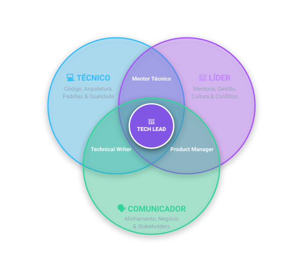
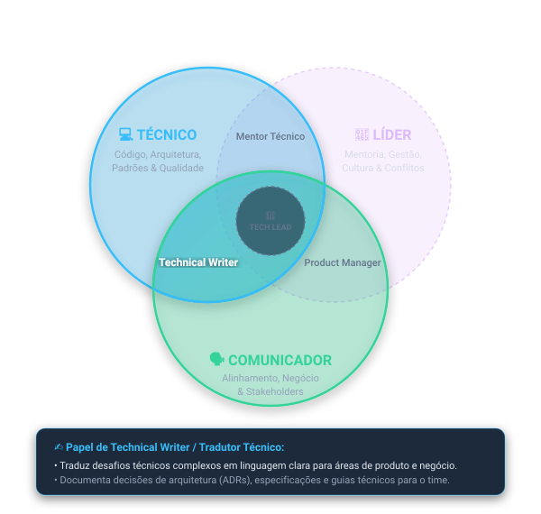
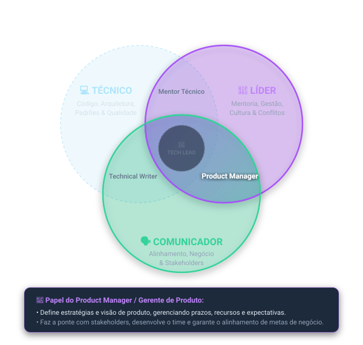
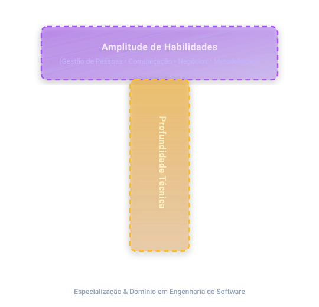
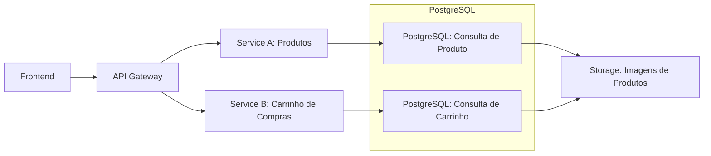

# O papel do Tech Lead

## Liderando com Excelência Técnica e Humana

1. O que é um Tech Lead?
   - Especialista Técnico?
   - Líder de Equipe?
   - Comunicador Eficaz?

   <br />

   -> O Tech Lead é um especialista técnico que lidera uma equipe de desenvolvimento de software. Ele é responsável por garantir a qualidade do código, a arquitetura do sistema e a entrega do produto.
   <br />
   -> Ele justamente faz a ponte entre a equipe de desenvolvimento e a gestão, garantindo que as necessidades do negócio sejam atendidas de forma técnica.
   <br />
   -> Em outras palavras, é a intersecção entre Técnico, Líder e Comunicador.

   <div align="center">

   

   </div>

2. Responsabilidades do Tech Lead

   ### Orientação Técnica
   - Decisões de Arquitetura: Definir a estrutura e os padrões do sistema.
   - Revisão de Código: Garantir a qualidade e a consistência do código produzido.
   - Resolução de Problemas Complexos: Abordar desafios técnicos que surgem durante o desenvolvimento.
   - Tech lead geralmente trabalha diretamente com algumas personas, como: Gerente de Projeto, PM, O Manager...
   - Basicamente é a pessoa que receberá problemas grandes, features/Requests bem grandes, ou seja, vai ser responsável em entender esses problemas e qual a melhor forma de abordar e resolver esses problemas, seja, querando em problemas menores , que possam ser 'atacados' de forma paralela pelo time
   - Entender quais são os riscos e as dificuldades que envolvem esses projetos também

   ### Gestão de Equipe
   - **Mentoria**: Auxiliar o desenvolvimento profissional dos membros da equipe.
   - **Distribuição de tarefas**: Alocar atividades com base nas habilidades e experiência dos desenvolvedores.
   - **Motivação da Equipe**: Criar um ambiente de trabalho positivos e colaborativo.

   ### Planejamento
   - **Estimativa de Esforço**: Avaliar o tempo e os recursos necessários para as tarefas.
   - **Alinhamento com Objetivos de Negócio**: Assegurar que o trabalho técnico suporta as metas estratégicas. É muito importante estar alinhado com o objetivo da empresa, saber para onde as 'coisas' estão se direcionando, para que de forma estratégica consiga ter uma visão melhor e consiga conciliar tanto a parte de código quanto a parte de negócio, pois, ambas são partes vitais e importantes para a empresa.
   - **Gerenciamento de Riscos**: Identificar e mitigar potenciais obstáculos no projeto.
     - Aceitar um certo risco é importante para que se possa crescer, ou seja, sair da zona de conforto, pois é somente assim que evoluímos. Desta forma, buscar identificar potenciais zonas de risco e avaliar se isso pode trazer uma instabilidade para o serviço ou até mesmo trazer/resultar em uma falha de segurança.
     - saber gerenciar esse risco e evoluir sem correr esse risco.

   ### Habilidades Necessárias
   1. Pontos necessários para ser um tech lead de alta performance
      - Técnico:
        - Conhecimento Aprofundado
        - Design de Sistemas
        - Adaptável

      - Líder:
        - Liderança
        - Comunicação Eficaz
        - Resolução de Conflitos

      - Comunicador:
        - Visão Estratégica: Ponto vital importante, aonde entender a visão estratégica da empresa em si, ou seja, para onde a empresa está querendo 'caminhar' ou evoluir, pode ser um diferencial nessa área.
        - Gestão de Projetos
        - Análise de Riscos

3. Desafios/Papel de Tech Lead
   - Equilíbrio Código/Gestão
     - Buscar entender o seu **split** (Percentual de tempo dedicado a cada atividade)
     - Um caso muito comum dentro das empresas hoje é o 70/30, ou seja, 70% de gestão e 30% de tempo por código.
     - Buscar se comunicar muito bem, entender esse balanço ou equilíbrio é algo fundamental, entendo assim o que a empresa espera de você.
   - Pressão por Resultados
     - Agora você será a pessoa que estará na frente do time
     - Será responsável por comunicar deadlines
     - Aceitar o desenvolvimento das features
     - Basicamente será a pessoas que eles vão chegar e perguntar:
       - A feature está pronta?
       - Vai ficar pronta até quando?
       - O que está faltando?
       - Qual o problema?
       - Como posso ajudar?
   - Diversidade de Equipe
     - É preciso saber como Líder entender o que cada um esta buscando e criar uma coesão no seu time, para que cada um se sinta desafiado na medida correta e também estar progredindo na velocidade correta.

## Tipos de Lideranças

### Liderança Técnica vs. Liderança Não Técnica

1. Liderança Técnica

- Técnico + Comunicador
  - Implementações:
    - O tech lead que vai sempre estar revisando os PRs, vai estar ativamente guiando seus liderados nas adoções técnicas.
    - É preciso imaginar que no dia a dia, estaremos lidando com pessoas de níveis diferentes, mas o importante é conseguir mostrar uma visão técnica muito bem solidificada, aonde você possa olhar para as pessoas e dizer 'você precisa corrigir especificamente isso, dentro do código, por causa de escalabilidade...' como por exemplo.
  - Eficiência dos processos: Trabalhar lado a lado com PM, para organizar tasks, analisar tasks grandes e quebrar em tarefas menores, que possam ser 'atacadas' de forma paralela pelo time.
  - Conhecimento especifico:
    - Muito importante o Tech lead ser aprofundado em alguma área específica...
    - Saber diferenciar/advogar quais são os prós e contras de algumas arquiteturas de sistema
      - Ex.: Quando eu devo utilizar um Monolito ou Microserviços
        - Monolito -> Nos leva para projetos menores, mais consolidade, sendo até mais fácil de gerenciar/trabalhar porque ele não é distribuido, mas chega determinados momentos que podem acontecer gargalos, resultando na situação de não ter tanta replicação...
        - Microserviços -> Nos leva para projetos maiores, mais complexos, aonde ele é distribuido, sendo até mais difícil de gerenciar/trabalhar, mas não acontecem gargalos, mas podem ficar mais caros...
        - Saber transformar um Monolito em Microserviços
        - Na parte técnica é necessário saber mostrar para as pessoas, para os stakeholders, quais são os prós e contras de cada tecnologia/arquitetura, para que o time possa se preocupar com a abordagem da implementação e o tech lead com a parte da arquitetura ou teórica de como o sistema vai evoluir depois de um tempo.
  - Busca definir a arquitetura de um novo sistema
  - Orienta a equipe na adoção de uma nova tecnologia
  - Realiza code reviews com foco em qualidade e boas práticas

  <div align="center">

  

1. Liderança Não Técnica

- Responsabilidades
  - Definir estratégias e metas organizacionais
  - Gerenciar recursos, prazos e orçamentos
  - Desenvolver a cultura e o ambiente de trabalho
    - Liderar para um lado mais 'humano' de soft skills
    - Olhar para os valores da empresa
    - Olhar para o lado de que time eu vou querer criar

  - Coordenar equipes multidisciplinares
    - Um exemplo é olhar para o Spotify hoje, aonde é adotado o conceito de 'Tribos', aonde a arquitetura organizacional é baseada em:
      - Tribos:
        - É o agrupamento de vários Squads que trabalham em uma área de negócio relacionada (ex.: Tribo de 'Música', Tribo de 'Pagamentos').
        - A Tribo funciona como uma 'incubadora' para os 'Squads', oferecendo um exossitema colaborativo.
        - Geralmente uma Tribo tem entre 40 e 150 pessoas para manter a coesão social e evitar burocracia excessiva.
      - Squads
        - É a menor unidade organizacional, análoga a um time Scrum(geralmente de 5 a 8 pessoas)
        - São autônomos e multidisciplinares, ou seja, possuem desenvolvedores, designers, especialistas em Produto (PO), etc.
        - Cada Squad tem uma missão de longo prazo (ex.: Melhorar o onboarding do usuário ou gerenciar a parte de pagamentos) e decide como vai atingir seus objetivos.
      - Capítulos
        - Como as pessoas estão espalhadas em Squads focados em produto, pode haver isolamento técnico.
        - O Capítulo resolve isso reunindo profissionais da mesma especialidade (ex.: todos os desenvolvedores Front-end de uma tribo ou todos os QAs).
        - O líder do capítulo ajuda no desenvolvimento de carreira e na padronização de boas práticas técnicas.
      - Guildas
        - É uma comunidade orgânica e voluntária de interesse comum que atravessa toda a empresa.
        - Qualquer pessoa pode criar ou participar de uma guilda (ex.: Guilda de Agile, Guilda de Testes Automatizados, Guilda de IA).
        - Serve para compartilhar conhecimento e alinhar padrões em nível global na companhia.

  - Desenvolver talentos e gerir performance
    - É importante olhar para o âmbito individual de cada um do seu time e saber quais os pontos fortes e fracos dessa pessoa, para que possa ser possível guiar essa pessoa, para que ela possa ter uma evolução na carreira. Como líder é necessário trazer desafios que aquela pessoa precisa participar para crescer.
    - Dar feedback na hora correta.
    - Reconhecer os pontos fortes dessa pessoa para que ela se senta acolhida dentro do time.
    -

- <div align="center">

  

### Qual a motivação?

- Ambos os estilos são essenciais e complementares.
- Em que área você se encaixa mais agora?
- Desenvolver quais habilidades para equilibrar a liderança?

### Comparativo: Liderança Técnica vs. Liderança Não Técnica

| Aspecto                    | Liderança Técnica                            | Liderança Não Técnica                       |
| :------------------------- | :------------------------------------------- | :------------------------------------------ |
| **Foco Principal**         | Aspectos técnicos e soluções tecnológicas.   | Gestão de pessoas e estratégias de negócio. |
| **Conhecimento**           | Profundo conhecimento técnico.               | Habilidades gerenciais e estratégicas.      |
| **Responsabilidades**      | Decisões técnicas, qualidade do produto      | Metas organizacionais, cultura da equipe    |
| **Interação com a Equipe** | Orientação técnica, mentorias especializadas | Desenvolvimento profissional, feedback      |

## Habilidades em T

### Profundidade Técnica e Amplitude

1. Porque é importante desenvolver habilidades em T?
   - Melhoria na Liderança.
     - Sabendo quais são as áreas que eu devo focar mais o meu conhecimento e as áreas que eu tenho mais amplitude, eu vou conseguir despender mais tempo ali na parte liderança
     - É necessário ter uma amplitude que não é só Técnica e para isso, será necessário se colocar em posições de decisões, momentos de decisões. Você vai ter uma autoridade nessa questão de liderança muito maior.
       <br />
       <br />
   - Comunicação Eficaz.
     - Justamente por saber quais são as áreas que a gente tem que ter no nosso desenvolvimento e ter a nossa amplitude, já podemos ver que o desenvolvimento de software agora vai funcionar linkando outras áreas da empresa
       <br />
       <br />
   - Tomada de Decisão.
     - uma das áreas mais importantes, para que como líder, eu possa ser justamente a pessoa que vai chegar para resolver conflitos, vai ser a pessoa que vai guias a sua equipe tecnicamente, então basicamente sai ali do papel de contribuidor individual, onde você vai estar sempre ali na frente das mudanças, fazendo todos os pull requests, para conseguir dar espaço para que o seu time inteiro vire essa força multiplicadora. Que o time inteiro consiga emular mais ou menos aquilo que você estava fazendo, que tanto você consiga aprender com ele, como eles consigam aprender com você. Para que ai a tomada de decisão, seja algo mais simples. Seja mudando alguma arquitetura, tomando uma decisão quanto a negócio, de quais são as features que devem ser feitas mediante um certo prazo. Então, porque você vai estar muito mais exposto a esse tipo de questionamento, esse tipo de pergunta, você vai ter uma melhora na sua tomada de decisão.
       <br />
       <br />
2. Entendendo o Gráfico em T

   <div align="center">

   

   </div>

   #### Barra (Eixo) Horizontal do 'T' -> Amplitude de Habilidades
   - **Gestão de Pessoas e Liderança:** Como liderança técnica, é necessário aprender bastante sobre os pontos abaixo, não quer dizer que você precise ser o maior especialista, a idéia é que você conquiste uma ampla camada de conhecimento que vão ajudar a progredir na sua carreira.
     - <span style="color: #4CAF50">Gestão de pessoas</span>
     - <span style="color: #4CAF50">Motivação</span>
     - <span style="color: #4CAF50">Desenvolvimento de talentos</span>

   - **Comunicação e Mediação:** Como Líder o seu papel também é dar 'palco' para a sua equipe, ou seja, é entender que é preciso mostrar o que meus desenvolvedores estão fazendo, é preciso guia-los corretamente, se caso ocorrer conflitos, é preciso que o líder seja o divisor de águas, ou seja, ser a pessoa que vai chegar e vai de forma edificante resolver o conflito para que as pessoas consigam tirar algo positivo dele.
     - <span style="color: #3b82f6">Apresentações</span>
     - <span style="color: #3b82f6">Reuniões</span>
     - <span style="color: #3b82f6">Resolução de conflitos</span>

   - **Planejamento e Negócio:** Na parte de planejamento, vai ser a parte aonde terá mais contato com stakeholders, vai estar em contato direto com as implementações de certas metodologias ágeis. E é justamente nessa parte de gestão que vai ajudar você a ter uma visão mais ampla do negócio e não apenas do desenvolvimento em si.
     - <span style="color: #ff6b00">Planejamento</span>
     - <span style="color: #ff6b00">Acompanhamento</span>
     - <span style="color: #ff6b00">Metodologias Ágeis</span>

   #### Barra (Eixo) Vertical do 'T' -> Profundidade Técnica
   - É preciso ter uma profundidade técnica excelente para quem já veio do desenvolvimento de software.
   - Neste ponto é aonde será investido a maior aprofundamento como profissional, porque, será necessário ser muito bom em resolver os problemas e ter um domínio avançado em áreas como arquitetura de software, padrões de design, escalabilidade, segurança, etc.
   - Neste ponto é preciso ter 100% de certeza das decisões que você esta tomando, então essa seria a diferença de ter uma amplitude, ou seja, uma gama de habilidades aonde você não necessariamente precisa ser o expert, o excelente, terão outras pessoas para isso, mas que você precisa ter conhecimento, para que aonde você de fato precisa ser o expert, precisa ser a pessoa que vai passar a confiança, que vai ter o conhecimento de fato solidifcado, para que você consiga não só ter condição de fazer as suas tasks, mas de ajudar o seu time a atingir uma velocidade interessante.

## Como desenvolver Habilidades em T?

- O que está faltando?
  - Como primeiro passo realmente entendendo o que está faltando para você nessas habilidades, pois, isso é algo pessoal.
  - Algumas pessoas tem habilidades técnicas, mas falta soft skills ou vice-versa.
  - É muito bom inicialmente ter essa introspecção para entender o que está faltando.
- Liderança e Gestão
  - Em seguida iniciar o processo de participar ativamente de reuniões de liderança e gestão, pois, ai você vai estar exposto a parte de tomada de decisão, basicamente tudo que é importante pro negócio da empresa, tanto as partes que são de tomada de decisão técnica como tomada de decisão não técnica, é extremamente importante que você esteja inserido ali, porque só assim você vai estar ali no ãmbito onde essas decisões vão estar sendo colocadas para você, que você vai estar sendo exposto para isso, consequentemente te tornando melhor nessa tomada de decisão e gestão.
- Mentorias e Networking
  - É necessário procurar alguém para ser o seu mentor e você dever ser o mentor de alguém, então aqui não é o bastante só que você tenha um mentor, mas sim que você se ponha na condição de mentor porque ai você vai estar exercitando skills necessárias para virar uma força potencializadora do seu time, que é exatamente importante.
  - Outro ponto importante que não pode ser ignorado, de certa forma, é o networking, pois é justamente esse ponto vai te fazer ter uma visão ou conhecimento de como outras empresas também já estão lidando com liderança, o que podemos estar apredendo com outros líderes, esse ponto é extremamente fundamental e extremamente importante.

## Próximos passos

1. Reflita sobre habilidades atuais

- É extremamente importante entender em qual cenário você está inserido no momento
- O que que te falta?
- Quais são as habilidades que você ainda não tem, para que você possa criar e entender minimanente o que você deve fazer a seguir.

2. Identifique áreas em que você pode expandir

- Criar mentalmente quais áreas deseja expandir
- Buscar entender como que eu quero evoluir em determinadas skills que ainda estão me faltando

3. Crie um [plano de ação](https://eight-tang-694.notion.site/Plano-de-A-o-para-Desenvolver-Habilidades-em-T-como-Tech-Lead-14225ff3155b80ac8eeac7989a8a2feb) para desenvolver

## os 3 pilares da Liderança Técnica

- Técnico
- Comunicador
- Líder

### Exemplos do Mundo Real

- #### Domínio Técnico
  1. Refrência para a equipe: Você será o ponto de consulta para dúvidas e desafios técnicos.
  - Confiança na capacidade técnica
  - Gerir a equipe com relação a capacidade técnica
  2. Deciões informadas: Capacidade de escolher as melhores soluções tecnológicas.
  - O qual você consegue explicar sobre determinada tecnologia
  - O quão você consegue deixar o time confortável para implementar uma nova tecnologia
  3. Orientações em melhores práticas: Guias a equipe na adoção de padrões de qualidade.
  - Ser uma mentor para orientar a equipe nas melhores práticas e guiar a equipe na adoção dessas mesmas práticas

- #### Comunicação e Colaboração
  1. Alinhamento de objetivos: Garantir que todos na equipe entendam a visão e as metas do projeto.
  - Trazer soluções que vão agregar ali dentro da empresa para solucionar um problema real.
  2. Resolução de conflitos: Abordar e resolver desacordos de maneira construtiva.
  - Conflitos são inevitáveis, até porque a equipe é feita de seres humanos.
  - Como líder saber abordar problemas de maneira construtiva
  - Saber identificar algumas fricções dentro do time e conseguir resolver elas de uma forma que todoss saiam ganhando.
  3. Engajamento da equipe: Promover um ambiente colaborativo e motivador.
  - Ser a pessoa que vai estar criando forma de como a cultura do teu time vai estar sendo implementada dentro da empresa.

- #### Visão Estratégica e Inovação
  1. Competividade no mercado: Manter a organização atualizada com as últimas tendências.
  - Buscar sempre garantir dentro da empresa que somos competitivos no mercado
  - Que estão alinhados com o negócio
  - Que os objetvos estratégicos da empresa estejam muito bem alinhados com os objetivos de tecnologia
  - Ser uma pessoa que busca sempre estar trazendo uma boa cultura de inovação e que esta permitindo também que as pessoas que estão sendo lideradas possam estar implementando essa cultura de inovação, sendo criativas e inovadoras dentro do time.
  2. Alinhamento com o negócio: Garantir que as soluções tecnológicas apoiem os objetivos estratégicos.
  3. Cultura de inovação: Incentivar a equipe a pensar de forma inovadora.

- #### Exemplos Práticos
  1. Exemplo Prático 1
  - Imagine liderar um projeto de desenvolvimento de software sem um conhecimento sólido da linguagem ou do framework utilizado. Isso vai resultar em decisões equivocadas, aumento de erros e desmotivação da equipe.
  2. Exemplo Prático 2
  - Ao implementar uma nova tecnologia, é crucial comunicar os benefícios, alinhar expectativas e incorporar feedbacks da equipe para uma transição suave.
  3. Exemplo Prático 3
  - Decidir migrar para a nuvem ou adotar inteligência artificial requer avaliar como essas tecnologias beneficiarão a empresa a longo prazo, além de planejar sua implementação de forma estratégica.

### Abordando a carreira dessa forma, teremos:

1. <span style="color: #ff6b00">Melhoria na Liderança</span>
2. <span style="color: #ff6b00">Comunicação Eficaz</span>
3. <span style="color: #ff6b00">Tomada de Decisão</span>

### Para chegar no resultado esperado, é necessário que:

1. Reflita sobre suas habilidades atuais.
2. Identifique áreas em que você pode expandir.
3. Crie um plano de ação para desenvolver.

# Gestão Técnica e Arquitetura

## Estratégias Técnicas - Pt1

1. Exemplo Prático 1
   - Imagine que você esteja trabalhando em uma aplicação de e-commerce. De repente, a equipe recebe um pedido urgente para melhorar a performance de uma página de produto que carrega lentamente. Você tem duas opções:
     1. Solução Local
        - Analisar toda a arquitetura em si e otimizar a consulta ao banco de dados apenas para a página de produto.
        - Mudança controlada foca em parte específica do sistema.
        - A entrega rápida dentro do prazo garantindo a velocidade do time.

     2. Solução Global
        - Verificar múltiplas partes do sistema.
        - Atualizar a camada de dados para utilizar um cache global.
        - Aprimoramento de desempenho em todas as páginas do site.
        - Entrega mais demorada.

## <span style="color: #57ffb6ba">Otimizações</span> - <span style="color: #914dffff">Locais vs. Globais</span>



1. Olhando a arquitetura do sistema de maneira macro e é decidido aplicar uma modificação no ponto DB1 e a princípio vai resolver o problema, será mantido a velocidade e vai desbloquear para eu possa me dedicar a outras tarefas
   - Essa não é uma solução errada, porém, o que pode acontecer aqui é que para que a decisão seja tomada como mais propriedade, é necessário se perguntar outras coisas. Nesse quadro, não pode so olhar para a arquitetura do sistema, num vácuo e tomar essas decisões, até porque la na frente elas podem causar gargalos ainda maiores e nesse ponto é necessário saber:
     - Como que ta a equipe?
     - Temos tempo de fazer uma solução melhor?
     - Nos temos tempo para chegar e fazer uma refatoração?
     - Temos tempo para chegar aqui e realizar um [benchmark](#o-que-é-benchmark) e ver como essa solução se comporta?
     - Temos pessoas suficiente no meu time?
     - Eu consigo entregar isso no prazo estipulado?
     - Nós temos tempo para testar diferentes soluções?
   - Se caso uma das respostas para essas perguntas acima for não, essa solução seria a sua melhor abordagem, ou seja, fazer uma otimização local, para que possa desbloquear, para que possa ter tempo de trabalhar em soluções mais robustas no futuro.
   - Desta forma, estaria pensando em uma solução por momento <span style="color: #ff0000; font-weight: bold;">Local</span>

2. Mas, podemos ter o caso também, aonde agora, mudaram os requisitos, agora temos bastante tempo, estamos confortáveis, temos um time de sêniors no projeto, que vai poder sim avaliar as coisas de uma forma mais holistica, aonde a gente possa ver o sistema como um todo e também não queremos apenas trazer uma melhoria local, mas sim uma melhoria global para dentro do nosso sistema, resultando em uma experiência melhor para o usuário.
   - Para isso podemos mudar a arquitetura do sistema, criar uma camada de cache.

     ```mermaid
     flowchart LR
         B1["Frontend"]
         B2["API Gateway"]
         B3["Service A: Produtos"]
         B4[Service B: Carrinho de Compras]
         B5["Storage: Imagens de Produtos"]

         subgraph "Cache"
            C1["Redis Cache: Cache de Produtos"]
            C2["Redis Cache: Cache de Carrinho"]
         end

         subgraph "PostgreSQL"
           DB1["PostgreSQL: Consulta de Produto - Falha no Cache"]
           DB2["PostgreSQL: Consulta de Carrinho - Falha no Cache"]
         end

         B1 --> B2
         B2 --> B3
         B2 --> B4
         B3 --> C1
         B4 --> C2
         C1 --> DB1
         C2 --> DB2
         DB1 --> B5
         DB2 --> B5
     ```

   - Aonde, agora todo mundo que for fazer uma consulta dentro do banco de dados para esse tipo de consulta ou coisas parecidas, tanto no carrinho de compras, como na listagem de produtos, nós teriamos aqui uma solução um pouco mais robusta.
   - Porque isso é interessante?
     - Se estivermos em um cenário, aonde temos a possibilidade de fazer a solução melhor, ela é sempre mais recomendada, quando temos pessoas que vão ter a capacidade de desenvolver essa solução melhor, aonde a gente consiga testar, consiga encaixar dentro de um prazo e pense no produto em si, com ele sendo um [Future-proof](#o-que-é-future-proof), para que possamos ter uma competitividade melhor, para que possamos entregar algo melhor no mercado e tudo isso vai ser definido no bom senso do Tech Lead de entender em qual situação o software se encontra, aonde o time se encontra e dependendo disso, iremos escolher tanto uma situação mais simples quanto uma solução mais robusta.
     - Todas as soluções estão certas e o papel do Tech Lead é entender de forma estratégica, ou seja, usar o seu conhecimento técnico, de forma estratégica, para saber quando que iremos usar cada uma delas.

## <span style="color: #57ffb6ba">Não Existe </span><span style="color: #914dffff">Fórmula Mágica</span>

### O Equilíbrio é a 🔑

- Ao longo do processo de otimização e tomada de decisões técnicas, é importante entender que não há uma solução única que funcione para todos os cenários. A chave para o sucesso é balancear soluções locais e globais de acordo com as necessidades específicas do seu sistema e do momento que o projeto se encontra.

### Como decidir? 🤔

| Questionamento                                                                  | Solução Local | Solução Global |
| :------------------------------------------------------------------------------ | :------------ | :------------- |
| **Qual é o impacto a longo prazo da solução?**                                  | []            | []             |
| **Quão crítica é a performance para o sistema agora e no futuro?**              | []            | []             |
| **O problema é pontual ou recorrente?**                                         | []            | []             |
| **Quanto tempo a equipe tem para implementar a solução?**                       | []            | []             |
| **Qual será o custo de manutenção da solução escolhida?**                       | []            | []             |
| **A equipe tem experiência para resolver o problema de forma global ou local?** | []            | []             |
| **Quais são os riscos de não escalar a solução agora?**                         | []            | []             |
| **Quais são as depedências externas do sistema?**                               | []            | []             |
| **Quais são os requisitos de segurança e compilance?**                          | []            | []             |
| **Como a solução impacta a escalabilidade do sistema?**                         | []            | []             |

**Dica**: Ao responder essas perguntas, tente sempre pensar no produto em si, nos usuários e no negócio. Isso ajudará você a tomar decisões mais alinhadas com as necessidades do projeto.

## Estratégias Técnicas - Pt2

### Pontos importantes

1. Detalhar o escopo técnico para alinhar e esclarecer tarefas.
   - Buscar entender como o escopo técnico pode ser uma âncora que vai atrasar todo o time, quando é mal feito, como também pode ser um trampolim que vai impulsionar a velocidade do time quando esta bem feito.
2. Utilizar exemplos práticos para destacar a importância de um escopo bem definido.
3. Qual é a melhor forma de chegar lá?

### Exemplo Prático

- Supoha que você precisa criar uma API de checkout para um sistema de pagamento no nosso E-commerce.
  - #### O Que Não Fazer

    ```mermaid
    flowchart TD
      B1["Objetivo"]
      B2["Criar uma API para pagamento"]

      LC1{"Criar uma rota de checkout."}
      B3["Que rota?"]
      B4["Precisa de auth?"]

      LC2{"Validar os dados."}
      B5["Que data precisa ser validada?"]
      B6["Como validar?"]

      LC3{"Integrar com algum serviço de pagamento."}
      B7["Qual API de pagamento?"]
      B8["Como lidar com os erros?"]

      B1 --> B2

      B2 --> LC1
      LC1 --> |Ambiguidades| B3
      LC1 --> |Sem Detalhes| B4

      B2 --> LC2
      LC2 --> |Ambiguidades| B5
      LC2 --> |Ambiguidades| B6

      B2 --> LC3
      LC3 --> |Sem detalhes| B7
      LC3 --> |Ambiguous| B8

    ```

    - Pontos a se considerar
      1. Com relação a primeira parte: "Criar uma rota de checkout."
         - Ambiguidade
           - O Escopo não ficou muito bem definido
           - Foi gerado ambiguidade porque, provavelmente surge o questionamento:
             - Qual rota?
             - Poderia serm /checkout? ou /finish-checkout?
           - Não foi criado tarefas de forma determinísticas
           - Essa tarefa, por poder ser feita de várias formas diferentes, não foi especificado o resultado que é esperado com o resultado dessa tarefa em si, dificultando o fato de dizer quando ela estará pronta e também quem ira testar essa tarefa.
         - Falta de detalhamento
           - Meu checkout vai precisar de autenticação?
           - Como será feito?
           - Como lidar com novos usuários?
           - Se não tiver autenticado, não poderei comprar?
      2. Com relação a segunda parte: "Validar os dados."
         - Ambiguidades
           - Quais dados precisam ser validados?
           - Eu sei como vou validar eles?
             - Será com um e-mail?
             - Será com uma biblioteca?
             - Validar com JS/TS?
      3. Com relação a terceira parte: "Integrar com algum serviço de pagamento."
         - Falta de detalhamento
           - Qual a API que vai ser utilziada?
           - O que eu posso fazer, no momento que o usuário fizer algo que não estiver detalhado?
         - Ambiguidades
           - Como lidar com os erros durante o processo?
      - Todos esses pontos/questionamentos podem se tornar um atraso, podem se tornar um retrabalho e esse retrabalho pode gerar fricção no time, com isso terá desenvolvedores mais frustrados e os prazos também em decorrer disso, ficarão mais apertados, porque é díficil chegar desta forma em uma completude.
    * Resumindo: O que não fazer?
      - Ambiguidades:
        - O que significa "Validar os dados?"
        - Como Deve ser feito?
      - Falta de detalhes:
        - Não há clareza sobre a autentição ou o serviço de pagamento
      - Incerteza para o time:
        - O time pode interpretar de formas diferentes as tarefas e as prioridades.

  - #### O Que Fazer

    ```mermaid
    flowchart TD
      B1["Início"]
      B2["Receber requisição POST /checkout"]
      BF["Fim"]

      LC{"Autenticação OAuth2"}
      B3["Retornar status 401"]
      B4["Validar dados com Joi"]

      B5["Retornar status 400"]
      B6["Processar pagamento com Stripe API"]

      B7["Retornar status 400"]
      B8["Gerar recibo"]

      B9["Enviar recibo para o usuário"]
      B10["Retornar status 200 com confirmação"]

      B1 --> B2

      B2 --> LC
      LC --> |Falha| B3
      LC --> |Sucesso| B4
      B3 --> BF

      B4 --> |Inválido| B5
      B4 --> |Válido| B6
      B5 --> BF

      B6 --> |Falha| B7
      B6 --> |Sucesso| B8
      B7 --> BF

      B8 --> B9
      B9 --> B10
      B10 --> BF

    ```

    - Pontos a se considerar
      1. Sempre levar em consideração os caminhos felizes e os caminhos de falha, para que na sua validação de espaço para testes e dar espaço para todos os 'corner cases', ou seja, todas as exceções.
      2. Com base no diagrama acima, quando formos aplicar essa transição para o Jira (ou qualquer ferramenta de gerenciamento de tarefa), ficará muito mais fácil de repassar para um PM ou até mesmo o próprio Tech Lead criar os tickets técnicos, sabendo validar o que esta sendo tratado no momento.
         - Exemplo: Utilizando a Stripe API, como mencionado acima, já sabemos que é algo que vem de uma third party, que e muitas vezes uma empresa ou algo que não temos controle algum sobre o que pode acontecer, que é uma lib que vai ser importada no nosso sistema e sendo assim, pensando já em testes, já pensamos em questão de mocks de uma api de pagamentos, para que eu possa testar, porém, isso so é claro para mim e pro meu time, quando temos essas definições e utiliza essas estratégias técnicas, para definir um escopo muito bem claro pra o meu time e assim poder alavancar o mesmo em questão de alinhamento, produtividade e entrega.
    * Resumindo: O que fazer?
      - Clareza: Todos sabem exatamente o que é necessário.
      - Dependências bem definidas: A integração com o Stripe e a autenticação com OAuth2 estão claras.
      - Tarefas divididas e sequenciais: Cada etapa é bem definida.

## <span style="color: #57ffb6ba">Escopo técnico para </span><span style="color: #914dffff">alavancar o time.</span>

- Buscando ou definindo escopos mais claros, uma definição mais clara, traz uma certeza maior para o time, diminui a fricção, aumenta a velocidade e garante que será entregue algo com valor, com testes, algo muito bem dividido, muito bem claro para todos e isso no fim vai alavancar a sua própria carreira e a carreira de todo time.
  <br />
  <br />

## <span style="color: #07fffbff">Lições </span>

- Para concluir, o detalhamento do escopo técnico é crucial para garantir que todos no time estejam alinhados e que a execução do projeto seja eficiente.
  <br />
  <br />

## <span style="color: #1cff07ff">Como chegar? </span>

| Checklist de Escopo Técnico                              | Feito? (☑️/✖️) |
| :------------------------------------------------------- | :------------- |
| O objetivo do projeto está claramente definido?          | ☑️             |
| As tarefas foram divididas em subtarefas menores?        | ☑️             |
| Todos os requisitos técnicos foram listados e definidos? | ☑️             |
| Os critérios de sucesso estão claros?                    | ☑️             |
| As tecnologias necessárias estão definidas e alinhadas?  | ☑️             |
| Existem estimativas realistas de tempo para cada tarefa? | ☑️             |
| A documentação esta planejada?                           | ✖️             |
| Existe um plano de testes claro?                         | ☑️             |
| Os riscos técnicos foram identificados?                  | ☑️             |
| O time esta alinhado sobre as prioridades?               | ☑️             |
| O projeto foi projetado com escalabilidade em mente?     | ☑️             |
| Existe um plano de manutenção para o futuro?             | ✖️             |

# Arquitetura do Sistema (Importância de Conhecer)

1. Conceitos fundamentais.
2. Por Que a Arquitetura do Sistema é Importante?
3. Ferramentas e Técnicas para Detalhar a Arquitetura.

## <span style="color: #79ffd9ff">O que é </span><span style="color: #9369d6ff">Arquitetura de Sistemas?</span>

- Como os serviços se comunicam.
- Como os dados são armazenados e acessados.
- Como a escalabilidade, segurança e performance são tratadas.

## <span style="color: #79ffd9ff">Ferramentas </span><span style="color: #9369d6ff">Técnicas</span>

- Mermaid: Utilize para criar diagramas de arquitetura.
- Utilize Confluence, Notion ou README.md para documentar e compartilhar a arquitetura com o time.
  - Com base nessas ferramentas pode se ter decisões importantes sobre arquitetura, quais os pontos fortes e fracos dessa aplicação, como que ela esta se comunicando, para que se possa traçar estratégias de como que se vai abordar as melhorias
- Monitoramento e Logs: Utilize ferramentas como Prometheus, Grafana e ELK Stack para monitorar a arquitetura em tempo real, identificando rapidamente gargalos e problemas.

### Exemplo Prático 🧑🏻‍💻🏗️

- Escalar um sistema de e-commerce que já está crescendo rapidamente.
  - Gargalos de perfomance quando o número de requisição aumenta.
  - Dificuldades de manutenção devido à faltade modularidade.
  - Problemas de integração quando novos módulos são adicionados.

  - #### O Que Não Fazer
    - O sistema pode enfrentar bloqueios e gargalos de desempenho com aumento de requisições.
    - A complexidade aumenta devido à dependência direta do pagamento ao banco de dados.
      - Foi criado um tight coupling entre o banco de dados de estoque e o banco de dados de pagamento, ou seja, um serviço agregado com outro, sem uma separação lógica, o que vai dificultar bastante de escalar.
    - A escalabilidade é comprometida pela falta de isolamento adequado dos módulos e comunicação não otimizada.
      - por esse ponto, se for necessário duplicar ou triplicar 100 vezes mais, não seria possível repetir essa arquitetura para chegar no ponto desejado, ou seja, no ponto em que o sistema vai, vamos dizer assim, não so imediatamente, mas em um ano ou posteriormente, demonstrar aonde ele poderia chegar.
  - #### O Que Fazer
    - A comunicação entre os microserviços será feita através de um API Gateway, centralizando e simplificando as requisições.
    - A segurança e autenticação do usuário são tratadas de forma centralizada.
    - O serviço de checkout se conecta ao serviço de pagamento de forma assíncrona, evitando bloqueios e aumentando a performance.
    - Resumindo, foi feito uma separação de comunicação de Microserviços, utilizando o API Gateway e então poderiamos ter vários desses serviços sendo substituídos, caso algum viesse a falhar, logo em seguida já iria subir outro.
    - Como essas camadas estão com isolamento melhor definido, fica muito mais fácil de escalar.
    - Então, desta forma, poderia ter uma segurança na parte até de autenticação, como todo mundo está conversando com Gateway, sabemos extamente como é que poderia fazer essa parte de autenticação.
    - Desta forma, foi criado menos dependência no código final.

### Progressão da aplicação | Monólito => Microserviços

- #### Início

  ```mermaid
  flowchart LR
    B1["Frontend"]
    B2["Backend: Sistema de Checkout"]
    B3["Cache"]
    B4["Database de Pagamento"]

    B1 --> B2
    B2 --> B3
    B3 --> B4
  ```

- #### Uma abordagem um pouco mais simples (sugestão)

  ```mermaid
  flowchart LR
    B1["Frontend"]
    B2["API Gateway"]
    B3["Service de Checkout"]
    B4["Payment Gateway"]
    B5["Database de Estoque"]
    B6["Cache"]
    B7["Database de Pagamento"]


    B1 --> B2
    B2 --> B3
    B3 --> B4
    B3 --> B5
    B3 --> B6
    B5 --> B7


  ```

  - aqui já temos uma melhoria, pois já temos o Frontend se conectando com API Gateway, ou seja, os serviços já estão mais separados
  - Agora já temos um "Serviço de Checkout, ou seja, uma tratativa/serviço de checkout, o que faz bastante sentido no e-commerce
  - Aqui podemos ver uma solução local, aonde o service de checkout ele se comunica com database de estoque, que também se comunica com database de pagamento e ao mesmo tempo o próprio serviço de checkout se comunica também com o payment gateway e o cache
  - Deu uma mellhorada do primeiro diagrama para esse, mas ainda não é exatamente o que estamos buscando.

- #### Uma abordagem mais interessante => Arquitetura de Microsserviços

  ```mermaid
  flowchart LR
    B1["Fronend"]
    B2["API Gateway"]
    B3["Service de Checkout"]
    B4["Service de Pagamento"]
    B5["Service de Estoque"]
    B6["Payment Gateway"]
    B7["Database de Estoque"]
    B8["Cache"]


    B1 --> B2
    B2 --> B3
    B3 --> B4
    B3 --> B5
    B4 --> B6
    B5 --> B7
    B5 --> B8

  ```

## Lições

- Conhecer a arquitetura do sistema é fundamental para garantir que você e sua equipe possam tomar decisões informadas sobre como escalar, manter e expandir o sistema no futuro.

### O que é Benchmark?

Na prática, o benchmark consiste em medir o desempenho de um sistema, produto, software ou processo usando **testes padronizados** (chamados de benchmarks). O objetivo é comparar esses resultados com:

1. **Outros concorrentes ou modelos** (para saber qual é superior em determinado quesito).
2. **Versões anteriores** (para avaliar se uma atualização melhorou ou piorou o desempenho)
3. **Padrões da indústria** (para verificar se o produto atinge o nível esperado pelo mercado)

### O que é Future-proof?

No contexto de tecnologia, engenharia e negócios, algo que é future-proof é projetado ou construído de tal forma que não se tornará obsoleto rapidamente, mesmo que o mercado mude, novas tecnologias apareçam ou os requisitos comecem a mudar drasticamente.

- Exemplos:
  1. Em software/Desenvolvimento: Escrever um código limpo, modular e escalável que aceite novas integrações no futuro sem precisar ser reescrito dom zero.
  2. Em Hardware (ex.: Placas de vídeos ou consoles): Comprar um componente que tenha potência de sobra para rodar softwares que ainda vão ser lançados nos próximos anos.
  3. Em Arquitetura/Negócios: Criar processos empresariais flexíveis o suficiente para sobreviver a crises ou a grandes reviravoltas digitais (como a inteligência artificial).
